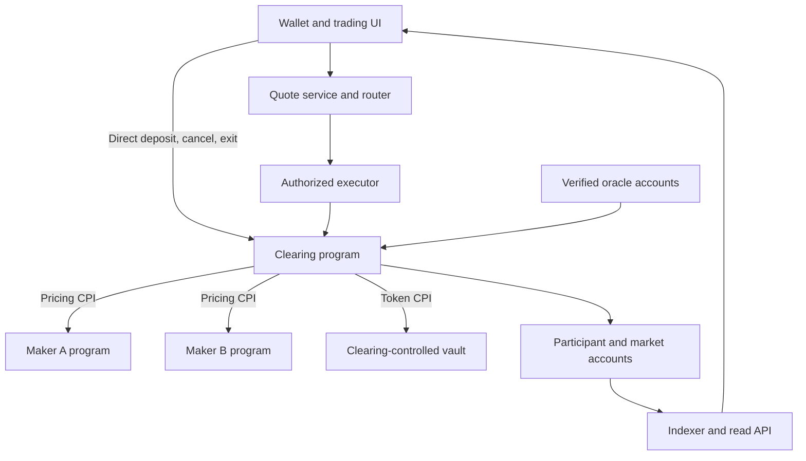

# Components and interfaces
Rivalt · baseline R1 · 20 October 2026

## Program-level boundary

The aggregator's on-chain action is the route entry point in clearing. It is not a fourth first-party program. Funding/risk/fees/settlement/default are clearing modules. SPL Token and upstream oracle verifiers are external dependencies. Local oracle/malicious-maker programs are clearly labeled test fixtures.

| Component | Operator | Responsibility and authority |
|---|---|---|
| Clearing | Venue scoped deploy/config/risk roles | Sole enforcement of custody, common accounting, risk, funding, settlement and orders |
| Maker A | Maker A keys/capital | Tight small-order spread, shallow depth and stronger inventory skew |
| Maker B | Maker B keys/capital | Wider initial spread, deeper piecewise capacity and distinct inventory sensitivity |
| Quote/router | Venue | Consistent cached inputs and eligible one/two-maker allocation; no custody authority |
| Maker daemons | Their respective operators | Read inventory/state, publish permitted configuration, reconcile fills/costs |
| Executor/order keeper | Venue initially; constrained action authority | Discover persisted intent, simulate, send, reconcile ambiguity |
| Oracle/funding worker | Venue initially | Post verified data and schedule authenticated samples, never dictate unchecked rate |
| Risk/settlement worker | Venue initially | Funded receiver liquidation, cash collection/settlement and paginated recovery |
| Indexer/PostgreSQL | Venue | Rebuildable read model, history and durable jobs; no authoritative balance creation |
| UI/API/SDK | Venue-maintained; wallet user-controlled | Quotes, signing, orders, cash/position views, direct exit |
| Scenario harness | Engineering | Explicit fixture provisioning and fault control; no fabricated successful protocol effects |

A/B can share interface/math libraries, but need different strategies, deployments, configuration accounts, credentials, capital and daemon processes. We operate both in the lab; external independence is M6.

## Authoritative account model

| Record | Required contents |
|---|---|
| VenueConfig | Domain/genesis/deployment identity; schema/config epochs; allowed dependencies, fee policy and scoped authorities |
| MarketState | BTC contract, quote mint/precision, action mode, funding state, caps and cash/reserve accounting |
| Participant | Owner/market, C/q/v, funding checkpoint/fraction, generation/nonce, reservations and four order slots |
| MakerRegistration | Stable maker ID, pricing program/config/version/authority epoch, capital participant, exposure limits and side/curve consumption |
| Registry pages | Stable full membership, identity and enumeration state needed for resolution |
| Vault | Classic SPL token account, clearing PDA authority, expected mint |
| Observation state | Source/strategy/config bindings, times/sequences, validity and common funding integration |
| ResolutionState | Frozen cohort/terms/funding/valuation, stage, progress and totals |

P02 freezes exact seeds, serialization, instruction/event/error versions and migrations. Do not accidentally allocate writable references to the same account under two roles. Normal fills touch only relevant participants and makers plus explicit market coordination; never scan the full registry per fill.

Shared market/funding/cash accounts, hot maker accounts and common fee payers remain potential write-lock bottlenecks. Measure before optimizing. PDA partitioning is not a throughput proof.

## Clearing instruction families

These are logical families, not an already generated IDL. ABI identifiers are pinned in P02/P03 and updated through reviewed versions.

- initialize/configure market and scoped authorities; register participant/maker; rotate/quarantine maker configuration.
- deposit and admissible withdraw; explicit insurance funding and restricted treasury transfer.
- execute immediate route and execute persisted-order subfill.
- place/replace/cancel order; create/cancel protective group; terminal cleanup.
- validate/sample funding and accrue account; collect loss and settle gain.
- liquidate under bounded progress; enter/value/collect/insure/impair/settle/finalize resolution.
- observe/enter restrictive mode and explicit recovery/new epoch.

No unimplemented family returns apparent success. Local profile may keep later operations disabled until their phase lands.

## Maker pricing interface

Inputs: schema/domain/market, maker/capital/config bindings, side, exact requested base lots, current inventory and funded capacity, current permitted oracle data, current cumulative consumption and effective time/slot.

Outputs: accepted/rejected, exact quantity, positive gross quote amount, remaining capacity, curve/config/terms epochs, start/expiry and rejection code. Bound sizes and encoding; verify the return-data producer. Response cannot add arbitrary extra fees or change the trader's limit.

The quote service evaluates equivalent math from the same labeled state. Maintain golden parity cases for A/B at boundaries, saturation, negative inventory, epochs and both sides. A sampled funding quote must be read-only with respect to consumption.

Maker updates are signed parameter/heartbeat/config transactions. Indicative quote requests do not require an on-chain update each time. Epoch transitions invalidate old assumptions; duplicate aliases cannot reset cumulative depth. Registered upgradeable modules need explicit authority/hash/version policy and quarantine on unapproved change.

## Service contracts

All monetary/quantity fields use decimal integer strings over JSON, plus explicit units/schema version. Internally use bigint/checked Rust types. Never parse financial integers through JavaScript Number.

| Surface | Minimum contract |
|---|---|
| Quote request | request ID, market, side, exact base quantity, trader for preview, limits/preferences |
| Quote response | snapshot slot/time/run/config/strategy epochs, per-maker size/gross amount, total fee, aggregate bound/VWAP, expiry, capacity and estimated network cost |
| Submit/attempt | authorized transaction or persisted order/version, exact route, durable economic ID, simulation and transaction identity |
| Execution response | signature, commitment observation, actual committed quantity/legs/fee, remaining authority and machine-readable failure |
| Position/balance | C, q, unpaid claim, risk equity, reservations, withdrawable amount, source/mode/as-of state |
| Orders | economic ID/version/group/generation, remaining quantity/fee budget, trigger policy and chain status |
| Market data | actual fills/candles, index/risk/funding series separately labeled, source freshness and valid coverage |
| Operations | dependency health, worker lag, reconciliation discrepancies, retry queues and resolution stage/progress |

P05 freezes actual endpoint names/pagination/errors in [INDEXER](P05-INDEXER.md); P06 freezes submission reconciliation. SDK is usable without API/UI for deposits, cancels and admissible withdrawals. The direct path must respect the same chain rules.

## Events and indexer

Critical events contain environment/domain, schema/terms/config epochs, market/participant/maker/order IDs, quantities/quote/fee/cash deltas, generation, and effective sequence/time. Each execution's paired changes must be reconcilable. Avoid ambiguous double-counting of a route summary and its leg details.

Prefer Anchor event-CPI for critical events; measure its overhead and decode inner instructions. If this mechanism cannot satisfy the measured runtime contract, record a concrete equivalent before P05 closes. Transaction status/state remains authoritative.

Indexer identity: environment/run ID + transaction signature + outer/inner instruction position + event ordinal. Failed transaction logs never create committed financial effects. Provisional observations must reconcile to confirmed/finalized status; websocket arrival is not finality.

Subscribe and buffer, backfill through a durable checkpoint, deduplicate then switch to normal processing. Commit event effects and checkpoint atomically in PostgreSQL. Duplicate/out-of-order delivery, missing metadata and RPC gaps are explicit states. Missing history is reported, not replaced with invented fills.

Store:
- append-only transaction/event observations and canonical projection status;
- participant/order/funding/cash read projections;
- durable submitted transaction bytes/identity and economic intent mapping;
- retry/jobs/outbox and worker checkpoints;
- quote candidates, rejected alternatives, source times and measurements.

Use SQL uniqueness and transactions to enforce idempotency. Recovery must reconcile accounts/vault against projections. A Surfpool reset starts a new run identity; never mix a fresh chain with old database history. Snapshot history retention must be tested, not assumed.

P05 implementation: `packages/indexer` is the separately runnable workspace service. Its schema-1 journal, finalized-only projections, initialization binding, 10,000-transaction bounded local recovery and HTTP contracts are specified in [INDEXER](P05-INDEXER.md). Confirmed observations remain provisional; unknown finality stays unresolved. The initial P05 zero funding/reservation profile is extended by P07 funding and P08 full order-book projections. P06 owns submission identity, quote candidates and economic retry jobs.

## Executor and operational workers

Persist signed transaction identity before broadcast. On timeout, inspect signature status and authoritative order/nonce before rebuilding. Blockhash expiry alone is not proof of nonexecution. Retries preserve economic authority and cumulative consumption.

Keep order, oracle/funding, risk and indexer roles separately restartable, with scoped keys/checkpoints. They may share one codebase/image. No Kafka, Redis or Kubernetes requirement.

Maker daemons log state/config changes, fills, inventory and costs. Paper hedge prices are marked simulated; they never become observed hedge fills or on-chain collateral.

Every worker exposes structured logs, readiness/liveness and metrics. Local supervisor waits for readiness, records PIDs/run identity and cleans up only its own processes. Recovery examples belong in ops/ as code lands.

## UI requirements

Provide deposit/withdraw, quote and order entry, per-leg result, position/cash breakdown, limit/stop/TP-SL management, fills/orders history, actual-fill chart and operations/error state. Test wallet rejection, account/cluster switch, ambiguous submission, stale quote/source, API outage and unpaid profit.

Use clear test-asset labels. Network cost, fee, execution impact and funding are separate. No speculative “guaranteed stop,” “instant cash profit,” global-best-price or production-TPS claims.

## Final repository layout

The kit supplies only README/AGENTS/SEED-PROMPT and docs. Create code directories when their phases need them.

| Path | Role | First phase |
|---|---|---|
| programs/clearing/ | Anchor clearing/routing/risk/custody | P01–P02 |
| programs/maker-a/, programs/maker-b/ | Separate pricing deployments | P03 |
| crates/financial-core/ | Shared checked economic arithmetic | P02 |
| crates/maker-interface/ | Bounded maker schema and evaluation types | P03 |
| packages/sdk/ | Generated modern client, direct execution paths | P01 |
| tests/anchor-conformance/ | Isolated legacy Anchor TS parity | P01 |
| tests/financial/, tests/svm/ | Independent exact model and compiled-program checks | P02 |
| tests/rpc-contract/ | Standard RPC/WS contract | P01 |
| tests/e2e/, tests/browser/ | Service lifecycle and actual UI flows | P06/P10 |
| services/api/, services/quote-router/ | Read/trading API and allocation | P04–P06 |
| packages/indexer/, services/workers/ | Chain projection and maintenance execution | P05–P09 |
| makers/daemon/ | Shared daemon code with distinct A/B configs/processes | P06 |
| apps/trader/ | React/Vite trading and operations UI | P10 |
| scenarios/ | Versioned deterministic/local/devnet scenarios | P02 onward |
| ops/ | Bootstrap, config, migrations/run manifests and recovery | P01 onward |
| docs/ | Current contracts, decisions, plan, worklog and evidence reports | Supplied |

No research-archive directory is required. New implementation evidence can live in docs/evidence/ as concise reports with commit/config identities; large reproducible runtime output should not bloat Git.

## P01 implemented interface

The initial clearing artifact exposed only the nonfinancial `probe` instruction described in [P01-SPINE](P01-SPINE.md). That probe remains an isolated ABI test and does not create participant, cash or market authority.

## P02 implemented interface

[ACCOUNTING-AND-CUSTODY](P02-ACCOUNTING-AND-CUSTODY.md) freezes schema/profile 1 and its exact IDL. Deployment identity/configuration lives in MarketState in this single-market profile; a separate VenueConfig is not yet needed. The stable registry is one bounded 64-member vector, with four order-ID slots on each Participant. P09 owns operational page traversal; P08 owns nonzero order-slot authority.

Seven custody instructions perform initialization, registration, deposit, withdrawal, insurance funding, surplus classification and custody pause. Initialization checks the real clearing ProgramData upgrade authority; later administration uses stored market authority. Financial state is advanced only by actual checked token CPI. `CustodyChanged` event-CPI includes a checked market sequence and explicit cash totals; failed transaction events never represent committed effects. The financial core's fill/funding/risk/default primitives remain model-only until their owning instruction phases.

## P03 implemented interface

[MAKER-CONTRACT](P03-MAKER-CONTRACT.md) defines fixed strategy version 1 for separately deployed A/B programs. Each exposes initializeConfig, publishEpoch and quote. Clearing adds registerMaker, approveMaker, syncMakerEpoch, quarantineMaker and read-only previewMaker. MakerRegistration and CapitalBinding are clearing-owned; config is maker-owned. Exact Borsh layouts are in the three generated IDLs; the response is bounded to 92 bytes. The CPI carries exactly one read-only config and no clearing authority. G04's preview reference is explicitly indicative; no financial execution is enabled.

The SDK exports separate makerA/makerB namespaces and a bigint quoteMaker evaluator. Codama names the shared participant seeds after the first capital role; the existing findParticipantPda API remains an alias of the generated findCapitalPda, with unchanged seeds and bytes.

## P04 implemented interface

[ATOMIC-ROUTES](P04-ATOMIC-ROUTES.md) adds executeRoute, initializeTestRoutes and publishTestRisk, a 97-byte TestRouteState PDA and critical RouteExecuted/TestRiskPublished event-CPI records. Immediate routes require the explicit local-test-profile compile feature and a live authority-published synthetic observation. The default compiled artifact rejects activation. Maker CPI retains the P03 single read-only config boundary. One/two-maker accounting, fee, nonce and consumption commit atomically; real deposits support exposed accounts, while trading-mode withdrawals remain disabled until guarded exits land. The pure bigint allocation core lives in packages/sdk/src/allocate-route.ts for later quote services; no server or PostgreSQL projection is claimed by this phase.

## P06 implemented interface

[LIFECYCLE](P06-LIFECYCLE.md) supersedes the P04/P05 settlement/exit boundary: clearing adds a 101-byte ExitGuard, bounded complete-cohort scans, sequence-bound collection/gain settlement and owner-signed trading withdrawals. The critical SettlementChanged event extends the finalized projection with exact C/v/P accounting. Default builds still reject these synthetic-profile financial paths; oracle/funding/order/default interfaces remain disabled.

`packages/services` supplies separately runnable API, executor, maker A/B and settlement roles. Wallet transactions are signature-verified and persisted as immutable exact bytes before broadcast. PostgreSQL operator reservations, identity-bound retries, finalized status/history reconciliation and maker heartbeats have explicit contracts in LIFECYCLE. Services share the existing indexer run binding and serialize schema migrations through a database advisory transaction lock. Maker CPI authority is unchanged.

## P07 implemented interface

[ORACLE-AND-FUNDING](P07-ORACLE-AND-FUNDING.md) adds initializeOracle/sampleOracle, embedded OracleState, materialized funding index/time and OracleObserved event-CPI. Route and settlement events include actual funding checkpoints; maker control changes invalidate the held configuration stamp. The separately restartable funding role uses the existing immutable transaction queue and its own explicit SOL budget. Signed local dependency publication is a clearly labeled fixture; it has no rate-setting or vault authority. The indexer reconciles full observation state and checkpoint-adjusted claims through actual RPC/WS/PostgreSQL.

## P08 implemented interface

[ORDERS](P08-ORDERS.md) embeds four durable order records and two protective groups in Participant. Owner-signed place/replace/cancel and pair/group operations are separate from permissionless executeOrder and terminal cleanup. Immediate executeRoute still requires the wallet signer. Cancellation uses only the owner, market, participant and event-CPI accounts; source and maker availability are not prerequisites.

OrderChanged and route/settlement snapshots preserve the complete book, remaining reservation, IDs and fee prefixes. The finalized indexer reconciles and rebuilds those fields; `/v1/orders` exposes effective eligibility and history. The services `orders` role uses a separate operator budget and immutable signed queue, at most one pending discovery job and a preferred 64-lot subfill. Maker CPI still receives one readonly config and no clearing writables or vault authority. Sensitive admission and funding coverage compute reservations from current bounds rather than trusting an old stored reserve.

D38 separates explicit deployment configuration and bounded regression fixtures from local raw run output. See [evidence storage](EVIDENCE.md). Raw captures remain in place; launchers and normal tests must work without them.
