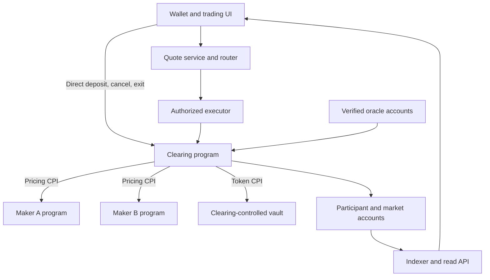

# Components and interfaces
Rivalt · baseline R1 · 20 October 2026

The following describes V1. [P17](P17-MARGIN-CONTRACT.md) audits these actual
interfaces and defines the additive schema-2 group/portfolio/margin layout.
`programs/clearing/src/state/v2/` contains its layout contract. [P18A custody](P18A-GROUP-CUSTODY.md)
adds separate group/portfolio/root instructions and generated codecs behind the
explicit successor local profile; P18A itself grants no trading activation. P18B–P21 add financial
instructions and group-aware services without mixing V1 history or granting maker
CPI new authority. WORKLOG records actual acceptance.

[P18B](P18B-ISOLATED-PRIMITIVES.md) adds `instructions/group_trading/`,
`financial-core::margin` and the group-bound `maker-group.rs` interface. Account
snapshots have separate event payload types without account discriminators.
The Codama generator explicitly retains V1's flattened instruction arguments
when a request type becomes shared; new contexts use distinct PDA names.
V2 PostgreSQL/API/workers/UI remain P21 deliverables.

[P18C](P18C-GROUP-SAFETY.md) separates `group_safety/settlement`, `risk` and
`resolution/{mod,ledger}`. The cash context nests its unchanged identity/token
constraints to fit the SBF frame while retaining all market/guard PDA checks.
Bounded cohort deserialization preserves the same Vec wire layout while allocating
once. V2 event CPI retains Anchor's exact tag/discriminator/authority and serializes
into one bounded buffer; legacy emission is unchanged. The generator now binds
public PDA helper names to seed schemas, preventing new alphabetical instruction
names from renaming the published V1/V2 helpers. New safety instructions and
resolution account/events remain separately typed. No new PostgreSQL projection
or operational service deployment is claimed by these program primitives.

## Program-level boundary

The aggregator's on-chain action is the route entry point in clearing. It is not a fourth first-party program. Funding/risk/fees/settlement/default are clearing modules. SPL Token and upstream oracle verifiers are external dependencies. Local oracle/malicious-maker programs are clearly labeled test fixtures.

| Component | Operator | Responsibility and authority |
|---|---|---|
| Clearing | Venue scoped deploy/config/risk roles | Sole enforcement of custody, common accounting, risk, funding, settlement and orders |
| Maker A | Maker A keys/capital | Tight small-order spread, shallow depth and stronger inventory skew |
| Maker B | Maker B keys/capital | Wider initial spread, deeper piecewise capacity and distinct inventory sensitivity |
| Quote/router | Venue | Consistent cached inputs and eligible one/two-maker allocation; no custody authority |
| Maker daemons | Their respective operators | Read inventory/state, publish permitted configuration, reconcile fills/costs |
| Executor/order keeper | Venue initially; constrained action authority | Discover persisted intent, simulate, send, reconcile ambiguity |
| Oracle/funding worker | Venue initially | Read sponsored Pyth Core primary accounts in the D36 devnet profile; publish the declared operator guard and schedule authenticated samples, never dictate unchecked rate |
| Risk/settlement worker | Venue initially | Funded receiver liquidation, cash collection/settlement and paginated recovery |
| Indexer/PostgreSQL | Venue | Rebuildable read model, history and durable jobs; no authoritative balance creation |
| UI/API/SDK | Venue-maintained; wallet user-controlled | Quotes, signing, orders, cash/position views, direct exit |
| Scenario harness | Engineering | Explicit fixture provisioning and fault control; no fabricated successful protocol effects |

A/B can share interface/math libraries, but need different strategies, deployments, configuration accounts, credentials, capital and daemon processes. We operate both in the lab; external independence is M6.

## Authoritative account model

| Record | Required contents |
|---|---|
| VenueConfig | Domain/genesis/deployment identity; schema/config epochs; allowed dependencies, fee policy and scoped authorities |
| MarketState | BTC contract, quote mint/precision, action mode, funding state, caps and cash/reserve accounting |
| Participant | Owner/market, C/q/v, funding checkpoint/fraction, generation/nonce, reservations and four order slots |
| MakerRegistration | Stable maker ID, pricing program/config/version/authority epoch, capital participant, exposure limits and side/curve consumption |
| Registry pages | Stable full membership, identity and enumeration state needed for resolution |
| Vault | Classic SPL token account, clearing PDA authority, expected mint |
| Observation state | Source/strategy/config bindings, times/sequences, validity and common funding integration |
| ResolutionState | Frozen cohort/terms/funding/valuation, stage, progress and totals |

P02 freezes exact seeds, serialization, instruction/event/error versions and migrations. Do not accidentally allocate writable references to the same account under two roles. Normal fills touch only relevant participants and makers plus explicit market coordination; never scan the full registry per fill.

Shared market/funding/cash accounts, hot maker accounts and common fee payers remain potential write-lock bottlenecks. Measure before optimizing. PDA partitioning is not a throughput proof.

## Clearing instruction families

These are logical families, not an already generated IDL. ABI identifiers are pinned in P02/P03 and updated through reviewed versions.

- initialize/configure market and scoped authorities; register participant/maker; rotate/quarantine maker configuration.
- deposit and admissible withdraw; explicit insurance funding and restricted treasury transfer.
- execute immediate route and execute persisted-order subfill.
- place/replace/cancel order; create/cancel protective group; terminal cleanup.
- validate/sample funding and accrue account; collect loss and settle gain.
- liquidate under bounded progress; enter/value/collect/insure/impair/settle/finalize resolution.
- observe/enter restrictive mode and explicit recovery/new epoch.

No unimplemented family returns apparent success. Local profile may keep later operations disabled until their phase lands.

## Maker pricing interface

Inputs: schema/domain/market, maker/capital/config bindings, side, exact requested base lots, current inventory and funded capacity, current permitted oracle data, current cumulative consumption and effective time/slot.

Outputs: accepted/rejected, exact quantity, positive gross quote amount, remaining capacity, curve/config/terms epochs, start/expiry and rejection code. Bound sizes and encoding; verify the return-data producer. Response cannot add arbitrary extra fees or change the trader's limit.

The quote service evaluates equivalent math from the same labeled state. Maintain golden parity cases for A/B at boundaries, saturation, negative inventory, epochs and both sides. A sampled funding quote must be read-only with respect to consumption.

Maker updates are signed parameter/heartbeat/config transactions. Indicative quote requests do not require an on-chain update each time. Epoch transitions invalidate old assumptions; duplicate aliases cannot reset cumulative depth. Registered upgradeable modules need explicit authority/hash/version policy and quarantine on unapproved change.

## Service contracts

All monetary/quantity fields use decimal integer strings over JSON, plus explicit units/schema version. Internally use bigint/checked Rust types. Never parse financial integers through JavaScript Number.

| Surface | Minimum contract |
|---|---|
| Quote request | request ID, market, side, exact base quantity, trader for preview, limits/preferences |
| Quote response | snapshot slot/time/run/config/strategy epochs, per-maker size/gross amount, total fee, aggregate bound/VWAP, expiry, capacity and estimated network cost |
| Submit/attempt | authorized transaction or persisted order/version, exact route, durable economic ID, simulation and transaction identity |
| Execution response | signature, commitment observation, actual committed quantity/legs/fee, remaining authority and machine-readable failure |
| Position/balance | C, q, unpaid claim, risk equity, reservations, withdrawable amount, source/mode/as-of state |
| Orders | economic ID/version/group/generation, remaining quantity/fee budget, trigger policy and chain status |
| Market data | actual fills/candles, index/risk/funding series separately labeled, source freshness and valid coverage |
| Operations | dependency health, worker lag, reconciliation discrepancies, retry queues and resolution stage/progress |

P05 freezes actual endpoint names/pagination/errors in [INDEXER](P05-INDEXER.md); P06 freezes submission reconciliation. SDK is usable without API/UI for deposits, cancels and admissible withdrawals. The direct path must respect the same chain rules.

## Events and indexer

Critical events contain environment/domain, schema/terms/config epochs, market/participant/maker/order IDs, quantities/quote/fee/cash deltas, generation, and effective sequence/time. Each execution's paired changes must be reconcilable. Avoid ambiguous double-counting of a route summary and its leg details.

Prefer Anchor event-CPI for critical events; measure its overhead and decode inner instructions. If this mechanism cannot satisfy the measured runtime contract, record a concrete equivalent before P05 closes. Transaction status/state remains authoritative.

Indexer identity: environment/run ID + transaction signature + outer/inner instruction position + event ordinal. Failed transaction logs never create committed financial effects. Provisional observations must reconcile to confirmed/finalized status; websocket arrival is not finality.

Subscribe and buffer, backfill through a durable checkpoint, deduplicate then switch to normal processing. Commit event effects and checkpoint atomically in PostgreSQL. Duplicate/out-of-order delivery, missing metadata and RPC gaps are explicit states. Missing history is reported, not replaced with invented fills.

Store:
- append-only transaction/event observations and canonical projection status;
- participant/order/funding/cash read projections;
- durable submitted transaction bytes/identity and economic intent mapping;
- retry/jobs/outbox and worker checkpoints;
- quote candidates, rejected alternatives, source times and measurements.

Use SQL uniqueness and transactions to enforce idempotency. Recovery must reconcile accounts/vault against projections. A Surfpool reset starts a new run identity; never mix a fresh chain with old database history. Snapshot history retention must be tested, not assumed.

P05 implementation: `packages/indexer` is the separately runnable workspace service. Its schema-1 journal, finalized-only projections, initialization binding, 10,000-transaction bounded local recovery and HTTP contracts are specified in [INDEXER](P05-INDEXER.md). Confirmed observations remain provisional; unknown finality stays unresolved. The initial P05 zero funding/reservation profile is extended by P07 funding and P08 full order-book projections. P06 owns submission identity, quote candidates and economic retry jobs.

## Executor and operational workers

Persist signed transaction identity before broadcast. On timeout, inspect signature status and authoritative order/nonce before rebuilding. Blockhash expiry alone is not proof of nonexecution. Retries preserve economic authority and cumulative consumption.

Keep order, oracle/funding, risk and indexer roles separately restartable, with scoped keys/checkpoints. They may share one codebase/image. No Kafka, Redis or Kubernetes requirement.

Maker daemons log state/config changes, fills, inventory and costs. Paper hedge prices are marked simulated; they never become observed hedge fills or on-chain collateral.

Every worker exposes structured logs, readiness/liveness and metrics. Local supervisor waits for readiness, records PIDs/run identity and cleans up only its own processes. Recovery examples belong in ops/ as code lands.

P11's [matrix contract](P11-MATRIX.md) composes the existing actual-runtime supervisors into distinct, uniquely bound environments. Its Python report consumes public evidence without importing financial implementations; it preserves scenario failures/not-run stages and intent/order populations. Test-only public intent export adds no service authority or API mutation. Hosted CI remains separate from real runtime acceptance.

## UI requirements

Provide deposit/withdraw, quote and order entry, per-leg result, position/cash breakdown, limit/stop/TP-SL management, fills/orders history, actual-fill chart and operations/error state. Test wallet rejection, account/cluster switch, ambiguous submission, stale quote/source, API outage and unpaid profit.

Use clear test-asset labels. Network cost, fee, execution impact and funding are separate. No speculative “guaranteed stop,” “instant cash profit,” global-best-price or production-TPS claims.

## Final repository layout

The kit supplies only README/AGENTS/SEED-PROMPT and docs. Create code directories when their phases need them.

| Path | Role | First phase |
|---|---|---|
| programs/clearing/ | Anchor clearing/routing/risk/custody | P01–P02 |
| programs/maker-a/, programs/maker-b/ | Separate pricing deployments | P03 |
| crates/financial-core/ | Shared checked economic arithmetic | P02 |
| crates/maker-interface/ | Bounded maker schema and evaluation types | P03 |
| packages/sdk/ | Generated modern client, direct execution paths | P01 |
| tests/anchor-conformance/ | Isolated legacy Anchor TS parity | P01 |
| tests/financial/, tests/svm/ | Independent exact model and compiled-program checks | P02 |
| tests/rpc-contract/ | Standard RPC/WS contract | P01 |
| tests/e2e/, tests/browser/ | Service lifecycle and actual UI flows | P06/P10 |
| services/api/, services/quote-router/ | Read/trading API and allocation | P04–P06 |
| packages/indexer/, services/workers/ | Chain projection and maintenance execution | P05–P09 |
| makers/daemon/ | Shared daemon code with distinct A/B configs/processes | P06 |
| apps/trader/ | React/Vite trading and operations UI | P10 |
| scenarios/ | Versioned deterministic/local/devnet scenarios | P02 onward |
| ops/ | Bootstrap, config, migrations/run manifests and recovery | P01 onward |
| docs/ | Current contracts, decisions, plan, worklog and evidence reports | Supplied |

No research-archive directory is required. New implementation evidence can live in docs/evidence/ as concise reports with commit/config identities; large reproducible runtime output should not bloat Git.

## P01 implemented interface

The initial clearing artifact exposed only the nonfinancial `probe` instruction described in [P01-SPINE](P01-SPINE.md). That probe remains an isolated ABI test and does not create participant, cash or market authority.

## P02 implemented interface

[ACCOUNTING-AND-CUSTODY](P02-ACCOUNTING-AND-CUSTODY.md) freezes schema/profile 1 and its exact IDL. Deployment identity/configuration lives in MarketState in this single-market profile; a separate VenueConfig is not yet needed. The stable registry is one bounded 64-member vector, with four order-ID slots on each Participant. P09 owns operational page traversal; P08 owns nonzero order-slot authority.

Seven custody instructions perform initialization, registration, deposit, withdrawal, insurance funding, surplus classification and custody pause. Initialization checks the real clearing ProgramData upgrade authority; later administration uses stored market authority. Financial state is advanced only by actual checked token CPI. `CustodyChanged` event-CPI includes a checked market sequence and explicit cash totals; failed transaction events never represent committed effects. The financial core's fill/funding/risk/default primitives remain model-only until their owning instruction phases.

## P03 implemented interface

[MAKER-CONTRACT](P03-MAKER-CONTRACT.md) defines fixed strategy version 1 for separately deployed A/B programs. Each exposes initializeConfig, publishEpoch and quote. Clearing adds registerMaker, approveMaker, syncMakerEpoch, quarantineMaker and read-only previewMaker. MakerRegistration and CapitalBinding are clearing-owned; config is maker-owned. Exact Borsh layouts are in the three generated IDLs; the response is bounded to 92 bytes. The CPI carries exactly one read-only config and no clearing authority. G04's preview reference is explicitly indicative; no financial execution is enabled.

The SDK exports separate makerA/makerB namespaces and a bigint quoteMaker evaluator. Codama names the shared participant seeds after the first capital role; the existing findParticipantPda API remains an alias of the generated findCapitalPda, with unchanged seeds and bytes.

## P04 implemented interface

[ATOMIC-ROUTES](P04-ATOMIC-ROUTES.md) adds executeRoute, initializeTestRoutes and publishTestRisk, a 97-byte TestRouteState PDA and critical RouteExecuted/TestRiskPublished event-CPI records. Immediate routes require the explicit local-test-profile compile feature and a live authority-published synthetic observation. The default compiled artifact rejects activation. Maker CPI retains the P03 single read-only config boundary. One/two-maker accounting, fee, nonce and consumption commit atomically; real deposits support exposed accounts, while trading-mode withdrawals remain disabled until guarded exits land. The pure bigint allocation core lives in packages/sdk/src/allocate-route.ts for later quote services; no server or PostgreSQL projection is claimed by this phase.

## P06 implemented interface

[LIFECYCLE](P06-LIFECYCLE.md) supersedes the P04/P05 settlement/exit boundary: clearing adds a 101-byte ExitGuard, bounded complete-cohort scans, sequence-bound collection/gain settlement and owner-signed trading withdrawals. The critical SettlementChanged event extends the finalized projection with exact C/v/P accounting. Default builds still reject these synthetic-profile financial paths; oracle/funding/order/default interfaces remain disabled.

`packages/services` supplies separately runnable API, executor, maker A/B and settlement roles. Wallet transactions are signature-verified and persisted as immutable exact bytes before broadcast. PostgreSQL operator reservations, identity-bound retries, finalized status/history reconciliation and maker heartbeats have explicit contracts in LIFECYCLE. Services share the existing indexer run binding and serialize schema migrations through a database advisory transaction lock. Maker CPI authority is unchanged.

## P07 implemented interface

[ORACLE-AND-FUNDING](P07-ORACLE-AND-FUNDING.md) adds initializeOracle/sampleOracle, embedded OracleState, materialized funding index/time and OracleObserved event-CPI. Route and settlement events include actual funding checkpoints; maker control changes invalidate the held configuration stamp. The separately restartable funding role uses the existing immutable transaction queue and its own explicit SOL budget. Signed local dependency publication is a clearly labeled fixture; it has no rate-setting or vault authority. The indexer reconciles full observation state and checkpoint-adjusted claims through actual RPC/WS/PostgreSQL.

## P08 implemented interface

[ORDERS](P08-ORDERS.md) embeds four durable order records and two protective groups in Participant. Owner-signed place/replace/cancel and pair/group operations are separate from permissionless executeOrder and terminal cleanup. Immediate executeRoute still requires the wallet signer. Cancellation uses only the owner, market, participant and event-CPI accounts; source and maker availability are not prerequisites.

OrderChanged and route/settlement snapshots preserve the complete book, remaining reservation, IDs and fee prefixes. The finalized indexer reconciles and rebuilds those fields; `/v1/orders` exposes effective eligibility and history. The services `orders` role uses a separate operator budget and immutable signed queue, at most one pending discovery job and a preferred 64-lot subfill. Maker CPI still receives one readonly config and no clearing writables or vault authority. Sensitive admission and funding coverage compute reservations from current bounds rather than trusting an old stored reserve.

### P09 risk and resolution interfaces

Clearing adds `liquidate`, `initializeResolution`, `freezeMarket`, `advanceResolution` and `recoverResolution`. `ResolutionState` binds the frozen registry identity, epoch, price/funding, stage/cursor, cash totals and at most 64 per-ID planning records. Each instruction takes the shared market coordination account. Liquidation requires the actual funded receiver's owner signature; default pages are permissionless and exact-order, while source-emergency entry and final resume require market authority.

`LiquidationApplied` includes both full changed participant states. `ResolutionProgress` includes the exact header, bounded row updates and compact balance changes; its finalization flag explicitly invalidates active order records, zeroes IDs/reserves/group allowances and preserves history/nonces. The indexer reconstructs and compares the complete accounts. Frozen reconciliation uses the resolution ledger's collected/applied adjustments instead of applying ordinary net-position equations to partially finalized accounts. Both APIs expose `/v1/resolution`; balance views distinguish planned and applied payments and keep withdrawals unavailable while frozen.

The separate `risk` process uses a 5,000,000-lamport operator budget and a real funded non-maker participant. It discovers bounded improving transfers or bankruptcy proofs, persists signed bytes through the existing queue and advances exact pages. It may check recovery sources but cannot resume the venue. Details and resource evidence are in [RESOLUTION](P09-RESOLUTION.md) and WORKLOG.

## P10 user and browser interfaces

`apps/trader` uses Wallet Standard through the existing modern adapter. `UserClient` reads the exact finalized cohort, verifies local deployment identity, reconstructs route instructions and independently evaluates maker prices. `balanceView` supplies the same labeled calculations to the API and browser. The client constructs direct cancel/cohort/withdraw/settlement instructions without a venue HTTP dependency. It persists signed bytes before submission and requires an independent exact RPC transaction fetch before labeling success finalized. Public configuration and recovery steps are in [TRADER](P10-TRADER.md).

Read API envelopes add genesis, initialization and domain binding. Optional bounded `latest=true` on events/trades returns the newest window in ascending order with no continuation cursor; existing `after` pagination is preserved and cannot be combined with `latest`. A browser never interprets cached service health as financial authority. Frozen balances expose planned versus applied resolution payments and disable ordinary actions.

P12 adds explicit bounded local resource options under [LOAD-SOAK](P12-LOAD-SOAK.md): loopback-only `soak24` worker budgets and a validated indexer recovery ceiling up to 200,000 transactions (default 10,000). Durable budget identity, unknown-outcome rules, finalized metadata and full candidate reconciliation remain unchanged. Actual long-run acceptance is pending.

P12 scheduling extension: new immutable service intents emit a run-scoped PostgreSQL notification within their INSERT transaction, delivered on commit. The separate executor uses it only as a wake-up hint; the existing 250 ms durable scan remains the fallback after notification loss/disconnect/restart. Public quote failures may include bounded reason codes for paused/account/source/observation restrictions; admission and signed-byte authority are unchanged.

### P12 quote dispatch admission

Public submission request identities cannot use the reserved `funding:`, `keeper:`, `maker:`, `maker-sync:`, `order:` or `risk:` prefixes. Worker pending checks use their actual persisted budget. Quote preparation reports `observation-update-pending` for a pending/unresolved operator-funded sample and `quote-expiring` when the selected expiry has <=10 slots left at processed RPC. Optional loopback `RIVALT_QUOTE_DISPATCH_MARGIN_SECONDS` is 0 (default) or 1; with the configured 2–5 second sampler it reports `observation-update-due` before the next scheduled sample. P12 declares margin 1/cadence 5 and reports the resulting availability cost. These guards do not extend quotes, promise execution or replace on-chain checks.

P12 quote responses additionally include read-only `audit` snapshot inputs (reference/bounds, accrued balances, consumed maker depth and effective-order counts) for independent exact quote comparison. This creates no new instruction or execution authority. Financial JSON remains decimal strings.

Trades, event cursors and candle open/close chronology order by the underlying numeric event sequence. Serialization as a decimal string must not cause lexical ordering (for example, 98 before 218). P12 adds real PostgreSQL coverage of that multi-digit boundary.

Quote audit candidates include maker version/start/exclusive-expiry slots; a mathematically attractive curve outside its current epoch window is unavailable to the independent comparator.

D35 refines P12 quote preparation: `/v1/quote` includes `snapshotCommitment: confirmed`. The SDK reads a confirmed cohort only for independent route-message validation, and the UI labels it provisional; ordinary balance/exit snapshots remain finalized. Pending funding permits preview only after the exact confirmed transaction decodes to the current market/domain/epochs/observation/validity/funding state at or before the preview slot. Unknown evidence blocks quoting. Durable intent state, budget release and indexer projections still require finalized evidence. Existing on-chain expiry, observation, nonce and price checks remain authoritative.

P14 introduces an explicit `solana:devnet` deployment binding across indexer, services, SDK and wallet UI; defaults remain local. Pinned program IDs, genesis and immutable initialization identity govern PDA/owner/event/instruction selection. Browser configuration cannot include provider query credentials. [The bounded devnet contract](P14-DEVNET-LIFECYCLE.md) and [A19 evidence](evidence/P14.md) record the actual bounded lifecycle, PostgreSQL recovery and Phantom registration; WORKLOG owns integration status.

D38 separates explicit deployment configuration and bounded regression fixtures from local raw run output. See [evidence storage](EVIDENCE.md). Raw captures remain in place; launchers and normal tests must work without them.

### P15A maker operator tooling

`packages/maker-kit` wraps the existing owner-scoped maker runtime with protected configuration, explicit market/domain/signer binding and separate executor operation. It constructs SDK deposit/publication examples without adding signing or on-chain authority. Its recorder takes one repeatable-read PostgreSQL snapshot of finalized state/events/fees/reservations; a separate exact-integer reporter reconciles ordinary fills, funding, cash settlement, capital flows and unpaid claims. Unknown economic event types fail closed. Reference valuations are historical, hedge costs are labelled assumptions and independent-operator validation is always false. See [the operator guide](P15A-MAKER-KIT.md). The qualification provisions actual local programs and services; it does not consume retained acceptance dumps or change any program/IDL/economic rules.

P16A adds optional `diagnostic` to existing quote-refusal responses: confirmed preview slot/sequence/observation, source mode/status, chain/sample time and validity slots. It is public read-only context, not signing/admission authority; all rejection predicates/order remain unchanged. The attempt recorder retains it for future cause attribution. [Operational readiness](P16A-OPERATIONS.md) defines separate quote/submission/fill populations, bounded recovery checks and remaining limits.

## 24 October 2026 — program source organization

Clearing separates persistent account layouts under `programs/clearing/src/state/`
from Anchor instruction contexts and handlers under `src/instructions/`. The root
`lib.rs` contains program IDs and delegates public entrypoints; `constants.rs`,
`error.rs` and `events.rs` own shared constants, stable errors and critical event
schemas. Oracle impact sampling and the resolution ledger have dedicated internal
modules. [The clearing source map](../programs/clearing/README.md) gives the reading
order and identifies the authoritative financial checks.

This is a source-organization change: serialized names/order, instruction arguments,
PDA seeds, error numbers, authority and economic rules remain unchanged. Descriptive
local names do not rename published wire fields. Anchor requires `ctx` in handlers
using `emit_cpi!`; generated client/CPI exports are explicit. A fresh IDL build also
refreshes the existing top-level profile description; its wire ABI is unchanged.

## P19 whole-account interfaces

The successor adds `setMarginDelegateV2`, `netMarginClaimsV2`,
`manageMarginOrderV2`, `executeMarginRouteV2` and `executeMarginOrderV2`.
The latter three nest the existing single-market account context and append the
other canonical writable market. Whole-account calls bind group sequence and both
observation sequences, use one Clock and materialize both funding prefixes. They
reuse the same book, maker authentication/read-only CPI and financial candidates.
The original isolated entrypoints retain their wire/account shapes.

Owner-only grants change root epoch/nonce and invalidate delegated orders; cash,
netting and maker configuration still require their original owner authorities.
`MarginAuthorityChangedV2` and `MarginClaimsNettedV2` carry the actual root snapshot.
`MarginOrderChangedV2` and `MarginRouteExecutedV2` use flat fields and include the
other market's actual state, so no materialized funding mutation is missing from
replay. Existing event layouts remain unchanged. Account sizes/PDA identities are
unchanged. New SDK generation and isolated legacy conformance verify the interface;
P21 owns its indexer/service consumers. Cross release remains gated through P19.

P20 adds authority-only `activateCrossGroupV2` using the existing activation
account context. Financial event kind 6 identifies explicit isolated-to-cross
group promotion; serialized account/event layouts are unchanged. The shared
safety handlers consume both markets, preserve both funding prefixes and apply
whole-account reservations/health. Complete resolution recovers to isolated group
mode before any explicit reactivation. [P20's candidate boundary](P20-CROSS-SAFETY.md)
distinguishes internal signed qualification from the ordinary disabled release.
