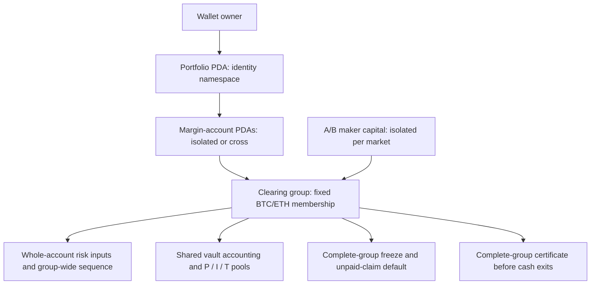
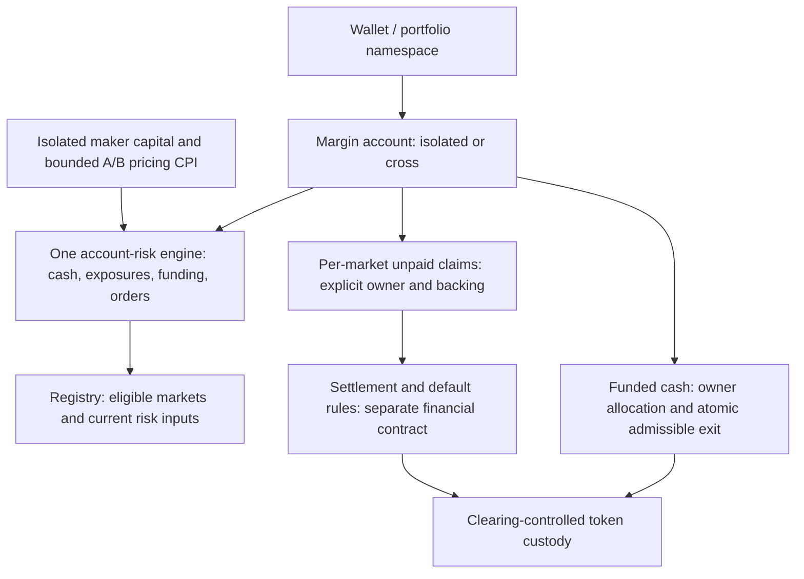

# P22 — account-centric clearing redesign

26 October 2026 · roadmap and design brief · P22A / D56

The user approves separating the responsibilities currently bundled into a clearing
group and requests this implementation roadmap. This document records that direction,
not a completed financial contract or an audit. The inspected baseline is
`9d3c295871136c356bf0028b0b2f9506e9391218`, following the integrated P17–P21 stack.
P22B must resolve the exact financial contract before dependent implementation.
Existing V1/V2 behavior and its recorded qualifications remain unchanged.

[P22B's developing financial contract](P22B-FINANCIAL-CONTRACT.md) now records the
funded-exit arithmetic, independent model checks and a concrete common-versus-market
loss-allocation decision. G17 is not complete; the reference is not on-chain evidence.

## 1. Current architecture and constraints

The account already owns its cash and liquidation boundary; the portfolio is not
a second collateral balance. The group adds economic and operational boundaries:
which markets belong together, settlement pools, default membership, freeze state,
and certificate/version coordination. These boundaries are unnecessarily coupled
for some operations, but deleting the group object alone would not remove them.

| Current implementation | Consequence | Planned treatment |
|---|---|---|
| [Group state](../programs/clearing/src/state/v2/group.rs) fixes two market keys and owns aggregate cash, P/I/T, mode and sequence | Market membership, financial pools and operational coordination share one object | Separate registry, account risk, settlement ownership and safety state |
| [Portfolio/root state](../programs/clearing/src/state/v2/margin.rs) binds every identity to a group | A cross account cannot select markets outside that group's fixed set | Venue-scoped identities and explicit per-market cross eligibility; initial qualification still only BTC/ETH |
| [Cash/transfer handlers](../programs/clearing/src/instructions/group_safety/settlement.rs) require a complete-group certificate | Unrelated activity can invalidate an otherwise healthy account's exit preparation | Prove and implement same-transaction account checks plus funded transfer/withdrawal; retain required safety/freeze checks |
| [Whole-account routes](../programs/clearing/src/instructions/group_margin/trading.rs) bind group and both observation sequences | Broad invalidation and shared locks; genuinely relevant changes must still reject | Separate replay authority, economic dependency versions and historical event ordering |
| [Funding/risk core](../crates/financial-core/src/margin.rs) counts cash once and negative market claims in full | Good conservative accounting to retain; source dependencies must remain complete | Reuse one engine, authenticate the complete account exposure/order set, prevent funding rollback |
| [Flat netting](../programs/clearing/src/instructions/group_margin/netting.rs) cancels claims within one group | Cross-market cancellation works under shared accounting, but cannot simply be moved into separate pools | P22B must specify corresponding pool/inter-market entries; no unbacked cash credit |
| [Group resolution](../programs/clearing/src/instructions/group_safety/resolution) values all members and impairs positive account-net claims | Isolated unpaid gains share the group default cohort; allocated healthy sibling cash is not automatically seized | Define loss ownership independently of account mode; preserve complete deterministic resolution of the chosen liability cohort |

[P21B evidence](evidence/P21B.md) reports 0/3 busy-group exit attempts versus 3/3
quiescent exits. That is a specific measured limitation, not proof that every exit
always fails or that the redesign already fixes it. The new qualification must
exercise exits while the normal sampler and unrelated trading continue.

## 2. Proposed responsibilities

These are responsibilities, not a promise of one PDA or program per box. Clearing
remains the enforcing program; A and B remain the two pricing programs. A shared
vault or safety account may remain where correctness requires it. Account locks,
vault writes and market sampling must be measured, not assumed to disappear.

The intended user experience is one cross account for eligible markets, or an
explicitly funded isolated account for a single market. The ordinary UI should not
ask users to choose a technical clearing group. Eligibility and default exposure
must still be disclosed. Registration, delegation, collateral allocation and mode
remain on-chain authority, not browser-only labels.

### Scope retained

- One six-decimal classic SPL test collateral, BTC and ETH initially; no additional
  market listing, unlimited portfolio capacity or production-scale claim.
- Separate portfolio namespace and margin-account ownership; no automatic sibling
  guarantee, pooled portfolio health or live margin-mode conversion.
- One accounting engine for isolated/cross accounts; maker capital isolated per
  market; common positions can open against A and close against B.
- Zero positive unpaid-profit margin credit and no correlation discounts. Fees,
  reservations and funding enter health exactly once.
- 2 bps taker / zero provider fee, current cumulative fee rounding, one/two-maker
  atomic FOK routes, partial persistent subfills and existing-position TP/SL.
- Current index-derived risk, source/funding safeguards, immutable signed retries,
  scoped delegation and read-only maker CPI with no vault signer.
- Complete, deterministic loss allocation. No keeper-selected haircut population.
- P15B/P16B remain external gates; 24-hour endurance stays Deferred. No outreach,
  paid services, external hedge or funded deployment is included.

### What changes, and what is not promised

1. **Market selection:** replace fixed account/group bundles with a registry and
   cross-eligible/isolated-only admission rules. Removing the bundle does not make
   every market safe for cross margin or remove bounded position capacity.
2. **Funded exits:** aim to check all of the withdrawing account's obligations and
   transfer the admissible funded cash atomically. A normal unrelated trade should
   not invalidate a historical group certificate because that certificate should
   no longer be its ordinary prerequisite. Insolvency/freeze, own health, relevant
   stale prices, custody deficits and execution limits remain real restrictions.
3. **Profit handling:** automate eligible collection/payment and show the unpaid
   remainder. Closing a position does not manufacture cash. Partial position closes
   must preserve remaining basis, fractions, funding and order/protection authority.
4. **Default:** define which claims bear a loss independently of the user's margin
   mode. Market-attributed settlement/default is the preferred option to evaluate,
   not an already selected guarantee of market-local losses.
5. **Transaction validity:** use the account nonce/authority, relevant terms, maker
   consumption and authenticated source/funding dependencies. A historical event
   counter must not automatically become a universal quote-validity lock. Do not
   accept omitted losing positions or a stale relevant observation to improve metrics.

## 3. P22B financial decisions and proof obligations

P22A intentionally separates the approved direction from the exact contract. This
is the reason for two P22 PRs: a reviewable roadmap now, followed by one concrete
financial specification/reference PR before financial implementation. The following
gates belong to P22B; no unresolved choice may be carried into its dependent phases.

| Question | Required contract / evidence |
|---|---|
| Can an ordinary funded withdrawal use only account-local financial checks? | Define pre/post cash, fully accrued adverse claims, reservations, custody conservation, safety epochs and concurrent transaction ordering. Candidate condition: `C_after*S + sum(min(U_risk,0)) >= (IM + R)*S`, after applicable costs. Prove why no unpaid liability is funded or shifted by the withdrawal; distinguish freeze discovery from future gap risk |
| Who owns settlement cash, insurance and a debtor shortfall? | Compare an explicit common loss domain with market-attributed pools/default. Select exact debtor allocation, insurance ownership, creditor cohort and freeze/recovery reach; explain residual cross-market contagion and operational dependencies |
| How does cross-market closed-claim netting conserve each ledger? | Keep it explicit, flat-only and within one account and permitted settlement domain. Specify matching cash or inter-market liability entries, cyclic claims, fractional ownership and default treatment. A receivable is not funded cash and cannot be spent twice |
| When may profit be paid? | Distinguish loss collection, gain eligibility, actual pool liquidity and funded cash withdrawal. Pin payment order, partial payment, early-payment/default timing and any solvency prerequisite; no silent guarantee, clawback or claim-purchase facility |
| Which dependencies can be omitted? | Instruction-by-instruction read/write and invalidation matrix derived from canonical exposure/order membership. Funding prefixes must never reverse or disappear after a held sample expires; future relevant obligations cannot be hidden by sparse account lists |
| What is the executable bound? | Exact account/PDA/event layouts, authorities, market/position/member/order bounds, frozen cohort representation and transaction envelopes. Start with existing bounded capacities; increases need measured evidence, not a new registry name |

Select ordinary implementation details autonomously. If the derived contract needs
positive unpaid credit, a new cross-market guarantee/credit facility, different
loss bearers or another material economic departure, present the concrete tradeoff
for a product decision before implementing that departure. Do not silently fall
back to a more convenient shared haircut rule. Current D45–D52 remain authoritative
for V2 until a version-specific supersession is recorded.

The cash proof and the profit-payment proof are separate. Paying a claim out of P
changes the remaining unpaid cohort and available backing. Withdrawing already
funded cash changes the vault and the owner's cash equally. This observation guides
the proof work; it is not, by itself, acceptance of a safe new withdrawal handler.

### Independent cases to carry through implementation

P22B supplies exact integer/Fraction expectations independently of Rust/SDK code.
Later owning phases compare those vectors with the real implementation, then signed
compiled programs and actual RPC/WS/PostgreSQL effects. Written examples alone pass
neither financial implementation nor deployment acceptance.

- Same cash counted once across two positions; positive unpaid gain never finances
  an open loss, reservation, fee or withdrawal.
- Withdraw/transfer with pending funding in the untouched market, active orders,
  partial TP/SL, revoked delegation, source expiry and competing account mutations.
- Busy unrelated account/market updates, versus genuinely changed own risk inputs;
  no maintenance pause in the normal-exit acceptance population.
- ETH-only distress with an unrelated BTC isolated winner; identify precisely which
  losses and freezes reach the winner under each proposed settlement model.
- A shared debtor with cash 100 and debts 80 in each market; insufficient total
  backing must not disappear. Compare and explicitly select creditor allocation.
- Flat opposite claims across markets, a two-account claim cycle, pool exhaustion,
  partial close and payment-before-default orderings; no cash from setoff alone.
- Whole-account liquidation that improves the ratio but worsens the post-fee
  deficit must reject; insufficient receiver capacity does not prove bankruptcy.
- Exact funding fractions through close/reopen, transfers, page boundaries,
  default and recovery; maximum membership, duplicate/omitted/foreign pages and
  interruption at every externally persisted stage.

## 4. PR sequence and acceptance

Milestone **M8**: account-centric clearing in a fresh bounded local test profile.
Dependencies are sequential in the order below. Each PR includes affected specs,
decision records, actual scoped checks and WORKLOG. A verified Review predecessor
may be used by the next stacked PR; only integration permits Closed.

| Phase / PR | Deliverable | Acceptance and activation boundary |
|---|---|---|
| **P22A — Architecture roadmap** | Current code map, diagrams, preserved scope, financial decision gates and this sequence | **A27A:** links/code pointers, numbering/dependencies and documentation consistency; no financial implementation or test claim |
| **P22B — Exact financial contract** | Resolve section 3; versioned state/authority/transition specification, loss/netting decision, deployment plan and independent expected cases | **A27B / G17:** conservation and counterexample review, executable independent references with exact outputs, all contract decisions pinned; these are model evidence, not implementation acceptance |
| **P23 — Registry, accounts and custody** | Fresh versioned venue/market identities, portfolio/root layouts, immutable modes/eligibility, actual deposits and debt-free custody exits | **A28 / G18:** generated SDK/isolated legacy parity, signed SBF and Surfpool custody/authentication/alias tests, independent token reconciliation; trading disabled |
| **P24 — Risk, funding and trading core** | Reusable account engine, complete risk dependency assembly, monotonic funding, relevant intent validity, maker routes, orders/reserves and TP/SL | **A29 / G19 core:** independent financial vectors against real candidates, signed enforcement/rollback checks in a qualification-only harness, maximum account/CU/packet measurements; ordinary financial activation disabled |
| **P25 — Cash, claims and atomic exits** | Selected settlement ledger, explicit flat netting, owner transfers and account-check-plus-withdrawal in one transaction | **A30 / G19 cash:** independent conservation/fractions, actual SPL transfers, pool exhaustion and payment timing, live sampler/unrelated-write tests, relevant stale/unsafe rejection; ordinary trading still disabled |
| **P26 — Liquidation, default and activation** | Whole-account post-fee liquidation, selected complete liability-cohort resolution, frozen/recovery states and qualified local activation | **A31 / G20:** actual signed full lifecycles, maximum cohort/all legal page sizes, shared-debtor/cycle/adversarial/restart cases, activation-negative tests and resource headroom; enable the new local profile only after safety passes |
| **P27 — SDK, indexing and services** | Direct account-aware SDK, versioned events/PostgreSQL/API, maker/funding/order/settlement/risk workers and immutable recovery | **A32 / G21 interfaces:** real Surfpool/RPC/WS/PostgreSQL lifecycle, fresh replay/raw-byte reconciliation, lost acknowledgement/restart, API-independent cancel/exit; no fixture-created financial success |
| **P28 — UI and fresh qualification** | Cross/isolated UX without technical group selection, cash versus claims, eligible markets, actionable restrictions and updated operator/maker guides | **A33 / G21 completion / M8 exit:** actual wallet/browser lifecycle plus pinned bounded concurrent qualification, normal exits without pausing sampling, faults/recovery, final reconciliation and new database replay |

P24/P25 harness execution is explicitly isolated test qualification, not a release
admin bypass. Default/devnet builds and ordinary new-profile activation stay closed
until P26. P26's program-level safety pass does not imply P27/P28 service readiness.
Any scope split needed after measured implementation evidence keeps the original
phase ID and explains the suffix; do not create one PR per field or test.

P28 must pin its duration, loads/account mixes, exit-attempt schedule and complete
offered/eligible/submitted/finalized denominators before acceptance. Compare affected
V2 behavior at the same declared conditions; retain rejected/censored attempts and
separate financial ineligibility, source restrictions, version invalidation, locks,
RPC failure and execution expiry. Require actual admissible exits while ordinary
background activity continues. A zero-exit run cannot pass by reporting only fills.
Measure packet size, account count, CU/headroom, hot accounts and p95/p99 latency;
preserve existing safety policy. This is bounded qualification, not a 24-hour gate,
unconditional exit guarantee or funded-readiness claim.

## 5. Versioning, sources and repository discipline

Use a fresh local versioned profile/namespace; P22B pins its precise ABI. Preserve
V1/V2 accounts, data, deployment identities and qualification history. No in-place
balance reinterpretation: migration requires an actually admissible old withdrawal
and explicit new deposit. Open positions, claims, fractions, insurance and fee
balances do not silently move. No existing devnet rollout is authorized here.

Phoenix is comparative reference, not Rivalt's accounting specification. Official
[accounts](https://docs.phoenix.trade/phoenix/collateral-and-accounts/accounts) describe
account-level collateral/risk boundaries; [collateral](https://docs.phoenix.trade/phoenix/collateral-and-accounts/collateral)
documents a global withdrawal queue; [margin math](https://docs.phoenix.trade/phoenix/margin-and-risk/margin-math)
permits discounted positive unrealized profit. That last policy is not adopted.
These sources do not establish market-local profit guarantees for Rivalt.

The user-supplied local `phoenix/` export contains a target binary and a readable
restart-handler/helper reconstruction, not a recovered complete financial source.
Its global-vault/queue fields and isolated-only admission diagnostics are useful
leads; they are not a full deployed-program verification or a verified coverage
percentage. Preserve the upload and the earlier design note untracked; do not
import binaries, archives or raw research into this PR.

Use existing locked tools and real local services. Run only phase-relevant checks;
do not rerun the inherited broad matrix for documentation or unchanged behavior.
Record tested commits/artifacts, actual failures and exact next actions. Raw evidence
stays local/ignored, concise reports and bounded regression fixtures stay in Git.
Ready-to-review PRs use `gh stack`; do not wait for a predecessor's merge to continue
once its required acceptance passes. Keep this new stack open pending review/merge
direction; prior stack-merge authorization is not automatic approval of future code.
