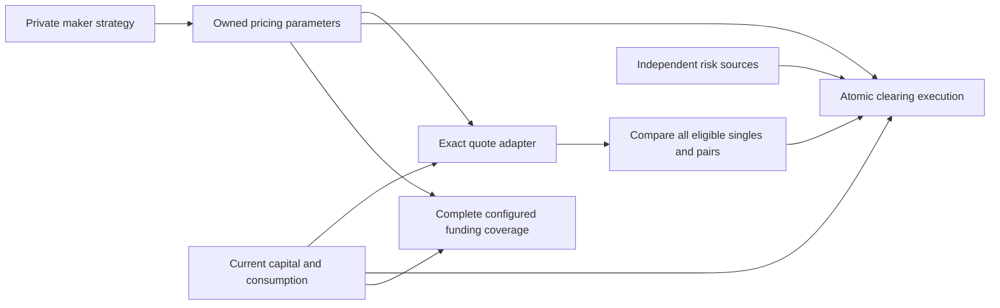

# P29–P34: programmable maker liquidity and bounded routing

28 October 2026 · M10 · D69/D70 · roadmap, not runtime qualification

## Objective and boundary

Deliver the five changes in [R077's assessment](MAKER-QUOTING-ASSESSMENT.md): a
common quote contract, configurable maker curves, separate repricing/replenishment,
strategy-independent bounded allocation, and matching clearing/funding safeguards.
The user accepts this direction and subsequently authorizes sequential implementation
(D70). P29A is the roadmap PR; [P29B](P29B-MAKER-CONTRACT.md) freezes the contract.
Later rows still require their own implementation/acceptance; deployment permission
is limited to bounded local qualification. WORKLOG owns live status.

Use the integrated schema-3 account engine. Preserve BTC/ETH, one test collateral,
per-market isolated maker capital, account risk boundaries, funded cash versus
unpaid claims, zero positive unpaid-profit margin credit, 2 bps taker/zero provider
fees, the 25% originating-market insurance allocation, TP/SL and complete default
accounting. Keep V1/V2 and the qualified V3 deployment readable and usable without
reinterpretation. No new borrowing, loss bearer or payout guarantee is introduced.

The new profile should demonstrate **at least three separately funded maker
instances per market**, including two using the same admitted implementation. Every
submitted route selects **at most two distinct maker capitals**. Three is the
initial design target, not a measured capacity claim. G22 must freeze an exact
registry bound and prove its resource feasibility before expansion is implemented.
Reducing qualification to the old fixed A/B pair would not meet this objective.
Do not count aliases of one capital account as independent depth.

First release: a common quote envelope and one canonical configurable curve family,
instantiated with contrasting strategies through the existing two maker programs.
Retain exact canonical arithmetic validation. Establish an adapter boundary and
reject unknown capabilities; arbitrary opaque/custom on-chain pricing modules are
a separately admitted future extension, not quietly activated by this roadmap.
Passive bin-like pricing is possible within this family, but existing spot pools,
public LP deposits, external hedging and signed private RFQs remain outside scope.

## Intended responsibilities

Discovery returns authenticated identities and dependencies. Quote adapters return
exact size-dependent amounts. A displayed book is a derived view, not reserved
liquidity. Clearing alone changes financial state, charges the fee, checks current
health and consumes depth. A maker reference never becomes a risk oracle.

## Sequence and acceptance

| Phase / PR | Outcome | Depends on | Acceptance |
|---|---|---|---|
| P29A | Roadmap, scope and phase-owned gates | Integrated P28A and R077 | A34A |
| P29B | Exact quote/update/routing/funding contract and independent reference | P29A | A34B / G22 |
| P30 | Configurable maker curves and authorized update lifecycle | P29B | A35 / G23 |
| P31 | Generic exact quote adapters and bounded best-pair allocator | P30 | A36 / G24 |
| P32 | Clearing, funding and safe local execution integration | P31 | A37 / G25; prototype continuation gate |
| P33 | Durable services, SDK, indexer, UI and maker kit | P32 gate passed | A38 / G26 interfaces |
| P34 | Comparative concurrent qualification and operations | P33 | A39 / G26 completion / M10 exit |

One cohesive ready PR per row; a phase can span runs. P29's A/B split deliberately
separates agreeing the roadmap from proving an exact executable contract, following
P22's convention. No automatic dozens-of-task-PR expansion. Use `gh stack` and
verified predecessor commits; keep unmerged work in Review. Do not merge this new
stack without a later merge instruction. D70 separately authorizes P29B–P34.

### P29A — roadmap

Record the accepted direction, existing-code gaps, deliberate future supersessions,
dependencies, acceptance and external boundaries. Validate links, phase/gate IDs,
status consistency and evidence policy. No program tests or new financial evidence
are required for this documentation-only PR. It does not close G22.

### P29B — exact contract before implementation

Audit the concrete V3 code and finish an independent integer reference, including
literal golden vectors and bounded exhaustive allocation examples. Freeze:

- Maker-instance identity versus program/strategy identity; capital uniqueness;
  admission, owner/updater authority, revocation, quarantine and upgrade policy.
- Versioned descriptor, config and consumption layouts, PDA seeds, ABI/events,
  bounded dependencies and fresh-local deployment approach. Reuse financial layouts
  where possible; no in-place migration or implicit reinterpretation of old accounts.
- Exact curve representation, tick/lot/quantity bounds, bid/ask direction, integer
  cumulative pricing, inventory trajectory, clipping and all rounding rules.
- Reprice, shape replacement, replenish, expire, disable and recovery transitions.
  Specify fragmented-fill equivalence/rounding bounds and prevent cheap-depth reset
  through new aliases, heartbeat or incidental configuration changes.
- Strict authority/shape epochs versus price/consumption sequences. Preferred
  candidate: use current prices/consumption within the user's explicit limit, while
  binding maker identities, exact leg sizes and security/shape authority. Resolve
  whether and how this differs from strict snapshot binding; no silent default to
  unlimited slippage, maker substitution or partial execution.
- Exact search guarantee: best feasible one/two-maker allocation within the admitted
  candidate set, with fees, lot rounding, position/order reservations, self-trade
  exclusion, capital deduplication and deterministic ties. Bound search work.
- Funding's fixed public quote context, complete required maker coverage, reference
  size, same capacity/pricing and two-maker execution constraint, causal accrual and
  missing-input handling. No special funding-only liquidity or keeper-selected subset.

**G22:** pin maker/region/dependency bounds, quote lifetimes, update sequencing,
search/latency budgets, transaction/account/compute envelopes, comparison workloads
and numeric continuation tolerances before measurements. Account for the existing
full ProgramData validation cost, maximum order books and funding's full coverage.
Retain packet fit and at least 20% measured compute headroom as later acceptance.
Any lookup-table dependency needs explicit provisioning/authority/recovery rules.
Design calculations are not signed-program budget evidence.

**A34B:** independent pricing and split examples, transition/race/counterparty
matrix, feasibility/search reasoning, exact ABI and resource plan; all G22 choices
resolved. If three makers cannot fit safely, report that as an objective change,
not a passed gate. No new financial instructions activate here.

### P30 — executable curve module and updates

Implement reusable canonical curves in the two maker deployments, independent
bid/ask depth, maker reference, inventory response, caps, finite validity, one-sided
and reduce-only modes. Implement owner-scoped update authority, monotonic update
sequences and distinct reprice/replenish/shape operations. Repricing preserves
consumption; replenishment never erases positions, cash, claims or risk.

**A35/G23:** independent reference versus real compiled-program and SDK quote
parity at all region/capacity/rounding boundaries; signed unauthorized, duplicate,
reordered, expired, alias and overflow cases. Exercise actual local RPC/WS update
and quote calls and measure their bytes/compute/latency. Generated ABI parity covers
only affected instructions/accounts. This is pricing/update acceptance; new financial
execution remains disabled. No PostgreSQL rebuild or broad historical suite here.

### P31 — routing independent of A/B identities

Introduce a bounded adapter contract for state acquisition and exact quoting, plus
derived depth hints. Separate discovery of N eligible makers from choosing one/two
execution legs. Evaluate every eligible singleton and unordered pair. Start with
bounded exact enumeration where practical; optimize via marginal costs/breakpoints
only with proof and independent exhaustive comparison under the full feasibility
constraints. Monotone prices alone do not prove monotone health feasibility.

**A36/G24:** compare against an independent exhaustive oracle over bounded domains,
including three-plus candidates, permutations, aliases, unequal depth, ties, gaps,
fee rounding, changing inventory, full books, source modes and insufficient margin.
Compare quotes with actual P30 programs. Measure worst configured search work and
latency; unsupported/nonconvex capabilities must reject or carry an explicitly
weaker guarantee, never inherit an exactness claim. Preserve exact-size FOK and
all-in limits. No claim of best prices outside the admitted snapshot/candidate set.

### P32 — first complete trading prototype and continuation gate

Integrate new maker registration/config validation and consumption into clearing's
immediate routes, persistent subfills and TP/SL. Implement the frozen update-race
policy, current whole-account funding/health and reservation checks. Rework funding
sampling to use the same executable pricing/capacity and search constraints, with
complete configured coverage and no consumed depth. Ordinary maker repricing must
not bump unrelated account/market security epochs.

Keep candidate execution behind a qualification-only gate until the affected safety
cases pass. Changes to price discovery must not strand liquidation, allow refresh
during unsafe modes, alter loss attribution, or credit positive unpaid profit.

**A37/G25:** signed compiled-program and actual Surfpool RPC/WS cases for fresh and
stale quotes, reprice/fill races, exhausted/shared capacity, failed second-leg
rollback, stored orders/protection, fee/insurance carry, funding gaps/manipulation,
margin shortfall, withdrawal/reservation races, maker quarantine and affected
liquidation/default/recovery. Independently reconcile financial effects. Measure
maximum-width routes and full-coverage funding, including packet and lock sets.
Use a narrow real PostgreSQL journal/replay fixture for the prototype; the full
public service implementation belongs to P33.

**Continuation gate:** run identical predeclared input schedules against the old
A/B baseline and the new canonical implementation, on separately pinned fresh local
deployments. Require zero unexplained financial/quote mismatches, all resource and
search limits met, consumption-preserving repricing demonstrated, best-pair parity,
and the G22 performance/rejection tolerances. Attribute improvements to mechanisms;
a more generous configured spread/depth alone is not a router improvement. Record
failed/rejected offers and network fees. Passing permits P33 once execution of this
roadmap is authorized; failure means repair this phase, not build UI over the issue.
Escalate only a material scope/economic departure or genuine external blocker.

### P33 — usable operator and trader integration

Deliver versioned SDK discovery/snapshots/transactions, maker daemon/configuration,
durable updater and execution retry policy, canonical funding worker, finalized
indexer/API reconstruction, and trader quotes showing chosen makers, actual all-in
price, expiry and classified unavailability. Preserve direct SDK exits and explicit
funded/unpaid balances. A displayed depth chart remains a labelled derived snapshot.
Update the maker kit's provisioning, quoting, permissions, reconciliation and exits.

**A38/G26 interfaces:** fresh operator setup; real Surfpool/RPC/WS/PostgreSQL and
browser-signed paths; interrupted/ambiguous updates and original-signature recovery,
maker/source outages, indexer restart and identical fresh replay. Reconcile fill
notional, inventory, funding, funded/unpaid P&L, fees and reserve contributions.
Internal makers and assumed/simulated hedges stay labelled. Do not rerun unrelated
inherited suites; leave supported broad regression to scoped hosted CI.

### P34 — measured qualification and engineering closeout

Run the G22-pinned bounded comparative workload with concurrent repricing, fills,
funding, orders, safe exits, recovery and replay on final artifacts. Include both
markets, isolated or two-position cross margin accounts, and all admitted maker
instances. Measure
offered, eligible, quoted, attempted, submitted and finalized populations separately;
classify every rejection/unavailability reason. Report size-sensitive execution
quality, quote drift, update-to-landing latency, p95/p99, search cost, bytes/compute,
account contention and maker economics including declared-horizon markouts.

**A39/G26/M10:** actual signed RPC/WS/PostgreSQL/browser evidence, no unresolved
signed financial effects, independent cash/claim/fee/default reconciliation, affected
incident/recovery/exit cases and documented limits. Only integrated verified phases
close M10. Passing technical checks is not proof of independent-maker profitability.
No 24-hour requirement is added; P15B/P16B remain Open external gates.

## Scope and evidence discipline

P29A plans; P29B resolves gates; P30/P31 prove pricing/search; P32 qualifies actual
financial integration before service expansion; P33/P34 make it usable and measure
the complete result. Runtime activation is local and gated, never inferred from
model tests. No new mainnet/devnet rollout, paid service, outreach or external hedge.
Keep raw evidence local/ignored, concise tracked summaries, exact tested commits,
selected test commands and failures. Preserve user research files untouched. No
archive import, independent-review claim or historical test-count reuse is needed.
