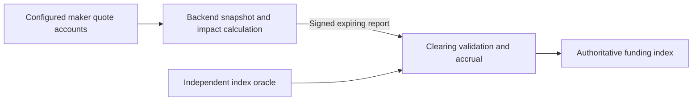

# P32 — restricted off-chain funding publisher

## Authority and current status

D75 records the user's acceptance of the restricted publisher proposal. This is
the approved direction for the fresh bounded local profile, not an implemented or
qualified publisher. P32 remains In progress above P31 PR #46. The current
`sample_liquidity_v4` implementation is the D74 on-chain published-depth sampler;
its 100-lot transaction succeeds at 1,334,329 CU but fails required headroom.
Retain that result as the superseded implementation's evidence, not a baseline
measurement for a publisher that does not yet exist.

Do not restart P29–P31 or add a separate phase/PR for each internal step. Deliver
one cohesive P32 PR after its revised acceptance passes, then stack P33 and P34
as already authorized. Preserve V1–V3, external P15B/P16B and deferred endurance.

## Selected boundary

The backend gathers a coherent snapshot of the complete configured maker set,
authenticates bindings/publications/code, and calculates published bid/ask totals
for the protocol reference quantity with the existing one/two-maker allocation,
depth/inventory/reduce-only caps, price bands and tie rules. D74's decision to omit
hypothetical financial admission remains in force. Reuse P30/P31's canonical
pricing and snapshot components; do not accidentally reuse the trader optimizer's
financial, fee or self-trade filters as funding policy.

The program authorizes the report publisher and validates a bounded report rather
than loading all maker accounts, hashing maker programs, invoking their quotes
and searching quantities on each sample. A report identifies its deployment/market,
configuration version, sequence, observation time/slot, expiry, Q and aggregate
bid/ask totals. Retain input provenance for independently reproducible audits;
a snapshot digest or publisher signature is not proof of correct aggregation.

The publisher must attest complete coverage and fresh valid maker inputs. Those
claims move to the publisher trust boundary; they are not described as fully
verified on-chain. A valid signed report can still be dishonest within accepted
price bounds. Limits bound the permitted effect; replay monitoring can detect
errors, but does not cryptographically prevent them.

On-chain authority remains narrowly scoped: the report cannot directly set an
arbitrary cumulative funding index, withdraw cash, change risk prices, bypass
trade margin checks or change fees/insurance. Clearing derives the bounded premium
and elapsed-time accrual using the independent index and authoritative Clock.
It materializes the preceding valid interval before installing a new prospective
observation. Reports cannot backdate funding or renew a cached input's freshness.

Observe account changes or slots in the backend, but initially publish on the
existing two-second cadence. Preserve six-second maximum hold, shorter input
expiry, recovery and outage behavior. Publication frequency is not a guarantee
of exact landing time. Keep financial admission at actual execution, independent
risk valuation, all-or-nothing routes and funded cash versus unpaid claims.

## Delivery inside the existing phases

| Phase | Deliverable and acceptance |
|---|---|
| P32: contract first | Freeze versioned publisher configuration/report/event layouts, exact units and sequence/expiry rules, config and publisher authority/rotation/revocation, structural-control invalidation, deployment/profile binding, unavailable-report behavior and independent-index/Q validation. Record exact supersessions before implementation. Ordinary details are implementation-owned; escalate material departures from this accepted boundary. |
| P32: executable publisher | Implement the restricted report handler and a minimal real off-chain snapshot/calculation/submission client. Update IDL/generated SDK and isolated legacy conformance. Supersede the expensive sampler as the fresh profile's authoritative funding path; prevent competing sampling entrypoints from changing the same funding state. Retain old profiles. |
| P32: close the trading prototype | Complete the already-planned immediate/stored-order/TP-SL execution, consumption, fee/insurance and affected safety integration. Prove publisher-fed funding and actual trading together using scoped real Surfpool RPC/WS, PostgreSQL replay and independent accounting. New trading remains disabled until full A37/G25 acceptance. |
| P33: durable operation and consumers | Integrate the qualified builder/handler into the durable funding worker, original-signature retries, budget tracking, restart/reconciliation, key rotation/revocation operations and input audit retention. Index report provenance and status; show index versus funding impact price, publisher age/unavailability and published versus financially executable depth. Update maker/operator instructions and browser flows. |
| P34: comparative qualification | Run the existing bounded comparative workload on pinned final code. Measure report construction and landing latency, coverage/gaps, actual transaction CU/bytes/fees, contention, publisher faults/recovery, trading/exits and exact accounting/replay. Label the publisher trust assumption and internal makers explicitly. No new 24-hour gate. |

P32 includes a functioning publisher client and actual submitted reports; it must
not close with only a handler or mocked reports and leave the essential producer
until P33. P33 owns durable service integration, not the first proof that funding
can operate. Existing P30/P31 evidence remains valid only for their unchanged
scopes; no historical result qualifies the new report authority or funding path.

## Required focused acceptance

- Independently derive impact prices at Q=100 and Q=600 from actual published
  maker state, including zero-cash publishers, declared-capacity limits, missing/
  stale inputs and both test markets. Verify builder results separately from
  on-chain report acceptance. No positive unpaid margin credit is introduced.
- Reject unauthorized, revoked, cross-deployment/market, replayed, out-of-order,
  expired/future and wrong-configuration reports. Pin behavior for equal sequence,
  duplicate original signatures, rotation and structural changes before coding.
- Test literal causal funding accrual, caps/rounding, rejected and unavailable
  reports, gaps/recovery, source invalidity and attempted backdating. Reports must
  not refresh independent risk sources or change unrelated user authority.
- Reconcile accepted reports, funding, resulting trades, fees and funded/unpaid
  balances from actual transactions through PostgreSQL and independent replay.
  Exercise publisher interruption and revocation without fabricating coverage.
- Measure complete update transactions and affected combined operations, including
  signatures, actual CU, bytes, loaded accounts and writable contention. Freeze a
  materially lower publisher CU target before its first benchmark; the old 1.4m
  envelope alone is not evidence this redesign achieves the requested efficiency.
  Retain 20% headroom and existing packet/heap bounds. Do not promise an unmeasured
  CU result or infer many-maker scaling from the current three-maker prototype.

Automatic temporary exclusion after repeated economic execution failures stays
deferred. Do not add an exclusion threshold, external operator, paid endpoint,
external hedge or funded deployment under this authorization.

## Immediate next action

Freeze the exact P32 publisher configuration/report transition contract and its
numeric resource target, then implement and test the handler plus real publisher
client on the existing P32 branch. Do not continue optimizing the superseded
on-chain exhaustive funding search as the chosen production path for this profile.
