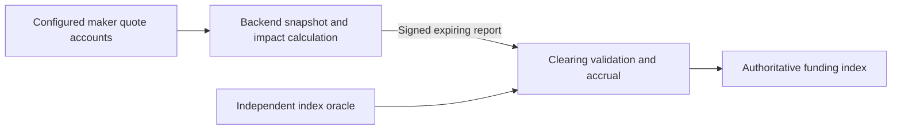

# P32 — restricted off-chain funding publisher

## Authority and current status

D75 records the user's acceptance of the restricted publisher proposal. D76 below
freezes its exact contract. R087 implements the gated configuration/report handler,
coherent off-chain builder and generated SDK; runtime qualification is pending.
P32 remains In progress above P31 PR #46. `sample_liquidity_v4` now rejects rather
than offering a second authoritative funding path. Its superseded D74 100-lot
transaction at 1,334,329 CU remains historical evidence, not a publisher result.

The clean `9129bda` client / `94e0645` program probe has seven accepted reports;
100/600-lot updates measure30,511/30,571CU,871bytes/v0 and14 keys. It stops at a
separate maker control's337,446CU headroom failure. The control candidate now avoids
repeating PDA searches after CPI, retaining complete pre-authentication and exact
post-CPI owner/layout/full-state verification. Remeasure before declaring this
scoped probe passed. Full P32 financial acceptance remains separate.

Do not restart P29–P31 or add a separate phase/PR for each internal step. Deliver
one cohesive P32 PR after its revised acceptance passes, then stack P33 and P34
as already authorized. Preserve V1–V3, external P15B/P16B and deferred endurance.

## Selected boundary

The backend gathers a coherent snapshot of the complete configured maker set,
authenticates bindings/publications/code, and calculates published bid/ask totals
for the protocol reference quantity with the existing one/two-maker allocation,
depth/inventory/reduce-only caps, price bands and tie rules. D74's decision to omit
hypothetical financial admission remains in force. Reuse P30/P31's canonical
pricing and snapshot components; do not accidentally reuse the trader optimizer's
financial, fee or self-trade filters as funding policy.

The program authorizes the report publisher and validates a bounded report rather
than loading all maker accounts, hashing maker programs, invoking their quotes
and searching quantities on each sample. A report identifies its deployment/market,
configuration version, sequence, observation time/slot, expiry, Q and aggregate
bid/ask totals. Retain input provenance for independently reproducible audits;
a snapshot digest or publisher signature is not proof of correct aggregation.

The publisher must attest complete coverage and fresh valid maker inputs. Those
claims move to the publisher trust boundary; they are not described as fully
verified on-chain. A valid signed report can still be dishonest within accepted
price bounds. Limits bound the permitted effect; replay monitoring can detect
errors, but does not cryptographically prevent them.

On-chain authority remains narrowly scoped: the report cannot directly set an
arbitrary cumulative funding index, withdraw cash, change risk prices, bypass
trade margin checks or change fees/insurance. Clearing derives the bounded premium
and elapsed-time accrual using the independent index and authoritative Clock.
It materializes the preceding valid interval before installing a new prospective
observation. Reports cannot backdate funding or renew a cached input's freshness.

Observe account changes or slots in the backend, but initially publish on the
existing two-second cadence. Preserve six-second maximum hold, shorter input
expiry, recovery and outage behavior. Publication frequency is not a guarantee
of exact landing time. Keep financial admission at actual execution, independent
risk valuation, all-or-nothing routes and funded cash versus unpaid claims.

## Delivery inside the existing phases

| Phase | Deliverable and acceptance |
|---|---|
| P32: contract first | Freeze versioned publisher configuration/report/event layouts, exact units and sequence/expiry rules, config and publisher authority/rotation/revocation, structural-control invalidation, deployment/profile binding, unavailable-report behavior and independent-index/Q validation. Record exact supersessions before implementation. Ordinary details are implementation-owned; escalate material departures from this accepted boundary. |
| P32: executable publisher | Implement the restricted report handler and a minimal real off-chain snapshot/calculation/submission client. Update IDL/generated SDK and isolated legacy conformance. Supersede the expensive sampler as the fresh profile's authoritative funding path; prevent competing sampling entrypoints from changing the same funding state. Retain old profiles. |
| P32: close the trading prototype | Complete the already-planned immediate/stored-order/TP-SL execution, consumption, fee/insurance and affected safety integration. Prove publisher-fed funding and actual trading together using scoped real Surfpool RPC/WS, PostgreSQL replay and independent accounting. New trading remains disabled until full A37/G25 acceptance. |
| P33: durable operation and consumers | Integrate the qualified builder/handler into the durable funding worker, original-signature retries, budget tracking, restart/reconciliation, key rotation/revocation operations and input audit retention. Index report provenance and status; show index versus funding impact price, publisher age/unavailability and published versus financially executable depth. Update maker/operator instructions and browser flows. |
| P34: comparative qualification | Run the existing bounded comparative workload on pinned final code. Measure report construction and landing latency, coverage/gaps, actual transaction CU/bytes/fees, contention, publisher faults/recovery, trading/exits and exact accounting/replay. Label the publisher trust assumption and internal makers explicitly. No new 24-hour gate. |

P32 includes a functioning publisher client and actual submitted reports; it must
not close with only a handler or mocked reports and leave the essential producer
until P33. P33 owns durable service integration, not the first proof that funding
can operate. Existing P30/P31 evidence remains valid only for their unchanged
scopes; no historical result qualifies the new report authority or funding path.

## Required focused acceptance

- Independently derive impact prices at Q=100 and Q=600 from actual published
  maker state, including zero-cash publishers, declared-capacity limits, missing/
  stale inputs and both test markets. Verify builder results separately from
  on-chain report acceptance. No positive unpaid margin credit is introduced.
- Reject unauthorized, revoked, cross-deployment/market, replayed, out-of-order,
  expired/future and wrong-configuration reports. Pin behavior for equal sequence,
  duplicate original signatures, rotation and structural changes before coding.
- Test literal causal funding accrual, caps/rounding, rejected and unavailable
  reports, gaps/recovery, source invalidity and attempted backdating. Reports must
  not refresh independent risk sources or change unrelated user authority.
- Reconcile accepted reports, funding, resulting trades, fees and funded/unpaid
  balances from actual transactions through PostgreSQL and independent replay.
  Exercise publisher interruption and revocation without fabricating coverage.
- Measure complete update transactions and affected combined operations, including
  signatures, actual CU, bytes, loaded accounts and writable contention. Freeze a
  materially lower publisher CU target before its first benchmark; the old 1.4m
  envelope alone is not evidence this redesign achieves the requested efficiency.
  Retain 20% headroom and existing packet/heap bounds. Do not promise an unmeasured
  CU result or infer many-maker scaling from the current three-maker prototype.

Automatic temporary exclusion after repeated economic execution failures stays
deferred. Do not add an exclusion threshold, external operator, paid endpoint,
external hedge or funded deployment under this authorization.

## Immediate next action

Run the scoped actual-RPC publisher probe against the D76 candidate, then complete
the existing P32 execution/safety/PostgreSQL and continuation acceptance. Do not
continue optimizing the superseded
on-chain exhaustive funding search as the chosen production path for this profile.

## Frozen publisher contract — D76

This resolves D75's implementation-owned contract before coding and benchmarking.
Scope remains the fresh profile4 local qualification artifact; V1–V3 are unchanged.

- `FundingPublisherV4` PDA: `["funding-publisher-v4", market]`, clearing-owned,
  140 bytes including the discriminator. Borsh field order: schema_version u16=4;
  venue, market, publisher Pubkeys; authority_epoch, last_sequence,
  last_observed_slot u64; last_observed_time i64; enabled bool; bump u8.
- `FundingReportV4` instruction payload: 203 bytes. Field order: version u16=1,
  domain [u8;32], market Pubkey; authority_epoch, sequence,
  expected_observation_sequence, expected_config_epoch, expected_terms_epoch,
  observed_slot u64; observed_time i64; valid_until_slot u64; valid_until_time i64;
  reference_price, quantity, bid, ask u64; outcome u8; input_digest [u8;32].
  Prices/totals are collateral atoms per lot / collateral atoms respectively.
  Digest is SHA-256 over the builder's versioned ordered raw snapshot, not a proof.
  Digest v1 encodes UTF-8 JSON `["rivalt-funding-snapshot-v1", context-slot decimal,
  rows]`, with address-sorted `[key,[owner,executable,base64-bytes]]` rows and null
  for absent accounts. Clock and RPC context are retained separately: the former
  supplies report time/slot, the latter orders discovery/final-batch reads. The
  program independently rejects future observed time/slot at landing.
- Outcomes: 0 available, 1 invalid independent sources, 2 unavailable/invalid maker
  coverage, 3 insufficient published depth. Unavailable reports have zero reference,
  quantity, bid, ask and both validity endpoints; all require a nonzero audit digest.
- Initialize requires venue authority in unpaused custody mode, initialized source
  bindings, a sealed complete registry and a nonzero publisher. Authority epoch=1,
  last_sequence=0; initial observed-slot/time fences are the authoritative Clock.
- Rotate/revoke requires venue authority and an exact current authority epoch.
  A nonzero new publisher rotates/enables; zero revokes. In custody/active modes,
  materialize/truncate old funding, advance market observation sequence and
  authority epoch, preserve report sequence, and fence observations at this Clock.
  Revocation is also allowed while paused/frozen/resolved/retired; outside custody/
  active modes it changes only publisher authority/fences and custody event
  sequence, not market/default financial state. Enabling outside custody/active
  modes or while paused is rejected. No publisher can rotate its own authority.
- Publish requires an enabled matching publisher transaction signer, no extra
  accounts, the profile gate and unpaused custody/active mode. Require exact venue
  domain/market, authority epoch, next report sequence (`last_sequence+1`), current
  market observation/config/terms epochs. Observed slot must be strictly newer than
  the config fence and no later than Clock; time must be nondecreasing, not future,
  and at most two seconds old. Available expiry must exceed Clock and be no later
  than observed time+6 seconds / observed slot+150. These caps do not independently
  prove the backend's declared input expiry; that is its attestation obligation.
- Independently read/authenticate the four existing source accounts on-chain. An
  available report requires Normal bounds and exact matching current reference;
  Q remains ceil(6,000,000/reference), ask>=bid>0 and each aggregate VWAP within
  90–110% of index. On-chain signed premium/cap and all funding arithmetic remain
  unchanged. Unavailable reports use the normal failed-observation transition.
- Accept only at the existing two-second sample interval. Accrue the preceding
  valid interval first; install the new sample from landing Clock, never from the
  historical observation time. Its hold also ends at the report's shorter expiry.
  Persist report sequence/observation fences and emit report plus resulting market
  state. Invalid reports revert every effect. Authority/control changes invalidate
  prepared reports through epoch/observation CAS; pure repricing retains the
  bounded snapshot-lag trust assumption and does not rewrite already-held funding.
- Disable `sample_liquidity_v4` in the new source; it cannot compete with reports.
  No new financial activation instruction is enabled by this replacement.
- Resource gate: submit publisher updates with 200,000 CU, require measured maximum
  <=160,000 CU (20% headroom), <=20 unique loaded keys, default32KiB heap and existing
  measured v0/v1 packet bounds. Initialize/rotate/revoke use the same 200k/160k gate.
  This is an unmeasured target. A miss requires repair or an explicit recorded
  contract change, not silent budget inflation. Route gates remain unchanged.

The backend must authenticate complete current maker coverage, preserve all
publication/depth/capacity rules, select exact best published one/two-maker totals
and use the earliest actual publication expiry. It must reject mixed/old snapshots,
record source inputs and never re-date cached observations. Default/devnet handlers
remain gated. P32 still owes source/financial integration, real RPC/WS/PostgreSQL
and all other phase checks before acceptance.
