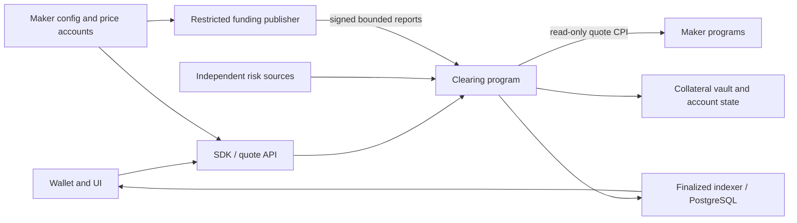

# Rivalt documentation

Rivalt is a Solana perpetual venue with common clearing and competing margined
maker programs. Clearing owns custody, account risk, funding, orders and settlement;
makers own pricing and their separately funded inventory. A position can open
against one maker and close against another.

The current qualified implementation is a bounded local BTC/ETH venue with one
six-decimal classic SPL test collateral mint, isolated/cross accounts, three maker
instances per market and two maker program deployments. Every submitted route has
at most two distinct maker capitals and commits atomically. Makers are internally
operated; this is not an external-venue router or a funded launch.

| Working on | Start here | Exact contracts |
|---|---|---|
| Accounts, money, risk, liquidation | [Clearing](clearing/README.md) | [Accounts](clearing/accounts.md), [accounting](clearing/accounting.md), [risk/default](clearing/risk-and-resolution.md) |
| Maker integrations, quotes, routing, funding inputs | [Liquidity](liquidity/README.md) | [Quoting](liquidity/quoting.md), [routing](liquidity/routing.md), [funding](liquidity/funding.md) |
| SDK, backend, indexer, wallet/UI | [Application](application/README.md) | [Interfaces](application/interfaces.md), [durability](application/durability.md) |
| Setup, execution, tests, deployment/recovery | [Operations](operations/README.md) | [Local development](operations/local-development.md), [deployment](operations/deployment.md), [validation](operations/validation.md) |

[STATUS](STATUS.md) owns current work and limits. [DECISIONS](DECISIONS.md) explains
material choices. [HISTORY](HISTORY.md) preserves original reports and superseded
contracts at immutable Git revisions. Read current component contracts before
historical references. Source still contains version-suffixed names and earlier
profiles; the active [consolidation plan](REPOSITORY-CONSOLIDATION.md) records their
pending refactor. Documentation does not claim those renames are already done.

## Product boundaries

Funded cash, unpaid P&L, risk equity, reservations and indicative cash headroom are
separate. Positive unpaid profit supplies no margin credit. Fees are 2 bps taker,
zero provider; 25% of collected fees goes to the originating market's insurance.
No token, fee tiers, public LP pool, borrowing or correlation discounts are added.

Supported orders include immediate exact-base FOK, persistent limits/stop-limits,
partial atomic subfills and existing-position reduce-only TP/SL. No entry-linked
bracket growth, trailing stops, general IOC or conventional price-time orderbook.
Portfolios organize ownership; margin accounts own cash and obligations. Mode and
isolated market are immutable. No live mode conversion or automatic old-account
migration is supported.

Independent index-derived bounds govern risk. Published funding depth is a
restricted publisher attestation and can be financially unexecutable; actual
trading still checks every touched account. Default accounts for the complete
cohort with market-attributed loss/insurance; shared debtors can transmit losses.
Neither isolated mode nor insurance guarantees profit payment.

Engineering success means real, exactly reconciled lifecycles under normal and
fault conditions. Commercial success requires returning independent traders,
competitive all-in costs and independently sustainable makers. Internal fills,
synthetic markouts and assumed hedges do not establish those outcomes.
