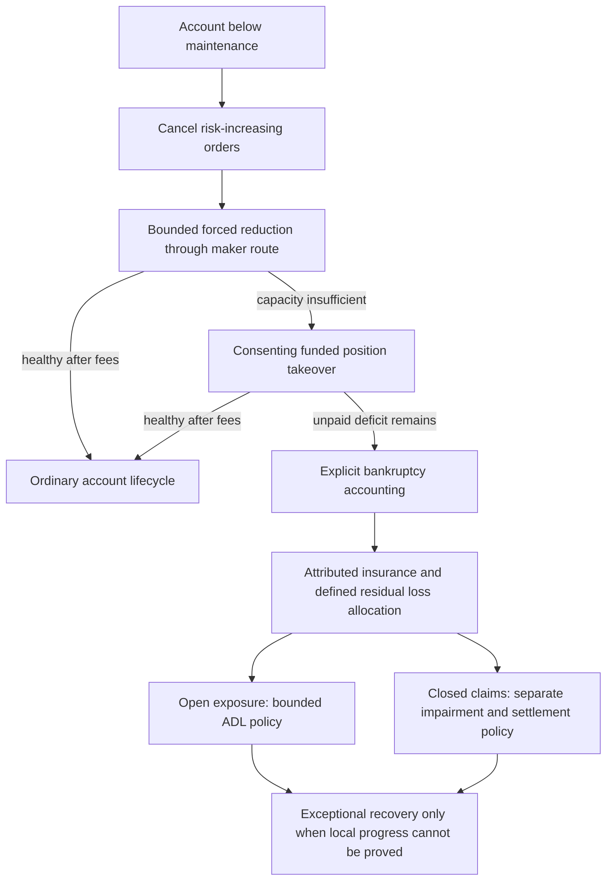
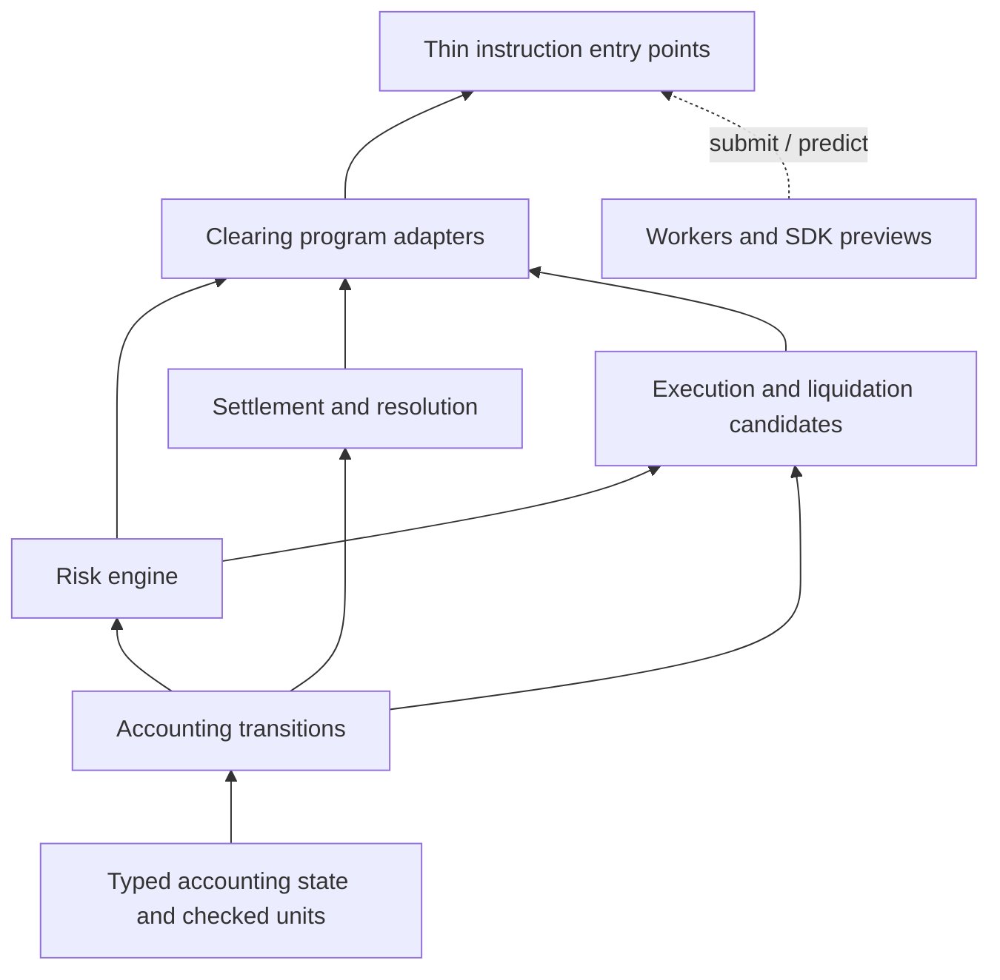

# Clearing architecture review

16–18 November 2026. [D112](../DECISIONS.md#d112--capped-adl-and-proportional-residual-recovery)
records the approved loss-handling target. The runtime still uses complete
proportional recovery. Rivalt source inspected: `07822f49dc9785989897f69d5361ea90717fdc11`
(accepted P56 source on the open stack). No program, account layout, economic
parameter, deployment or qualification result changes with this document.

## Executable settlement and liquidation comparison

18 November 2026. The [model](../../tests/financial/settlement_liquidation_model.py)
compares who receives collateral under the current complete-cohort settlement and
one candidate with auto-deleveraging (ADL). The [tests](../../tests/financial/test_settlement_liquidation_model.py)
give literal expected outcomes and pass eight frozen inputs through the existing
native Rust settlement kernel. The forced reductions themselves run only in the model.

### When a profitable close becomes cash

A trader buys one BTC lot from maker A at 80 and sells it to maker B at 100.
All three start with 100 collateral atoms. The example fixes funding and omits
ordinary trading fees to isolate the settlement entries. Each row is the state
after the indicated action. Tuples follow trader, maker A, maker B.

| Action | Net lots | Funded cash | BTC claims | BTC settlement cash |
|---|---|---|---|---:|
| Open at 80 | +1, −1, 0 | 100, 100, 100 | 0, 0, 0 | 0 |
| Value at 100 | +1, −1, 0 | 100, 100, 100 | +20, −20, 0 | 0 |
| Close at 100 | 0, −1, +1 | 100, 100, 100 | +20, −20, 0 | 0 |
| Collect 20 from A | 0, −1, +1 | 100, 80, 100 | +20, 0, 0 | 20 |
| Pay the trader 20 | 0, −1, +1 | 120, 80, 100 | 0, 0, 0 | 0 |

A's open short survives collection. If the price returns to 80, A acquires a new
+20 claim and B owes 20. The trader keeps 120. This example needs no advance
from insurance. It assumes current funding, qualified sources, a valid backing
proof and sufficient debtor cash. It measures no time to obtain those inputs.

| Transition | Who can initiate it | What changes or stops it |
|---|---|---|
| Ordinary close | Authorized trader through the route | Paired lots and claims change at execution. Actual routing admits the trader and each maker against their limits and margin. |
| Collect and pay | Settlement worker or another eligible caller under program checks | Collection moves cash from a debtor that can cover all gross negative claims. Payment converts a whole claim into account cash against funded market settlement and a current backing proof. Only the owner can subsequently withdraw to an authorized destination under the exit rules. |
| Partial liquidation | Consenting funded receiver under the current liquidation instruction | The target sheds lots, the receiver takes exposure and earns the bounded fee. Target maintenance deficit must fall after the fee and receiver initial margin must hold. The model checks a single-price, empty-order case. |
| Freeze and terminal settlement | Permissionless qualifying freeze or the existing authorized emergency path, followed by the resolution worker | The current program fixes the cohort and qualified valuation, collects once, uses each market's insurance against its own loss and reconciles payouts. A proposed allocation cannot authorize a transfer. |
| Candidate ADL within a freeze | Model supplies a debtor, an opposite position and its entry price | A forced paired close transfers part of an eligible winner's unpaid open gain to the debtor through its execution price. The same terminal solver then settles the adjusted claims from the original reserves. Authority, ranking and entry-basis provenance would need a separate contract. |

The current [cash contract](accounting.md), [receiver handler](../../programs/clearing/src/instructions/account_safety/risk.rs)
and [resolution contract](risk-and-resolution.md) define full eligibility.

### Who bears ten missing atoms

A BTC debtor owes 100. One flat creditor is owed 60 and one creditor with an
open long is owed 40. The debtor supplies 80 and BTC insurance supplies 10. The
table shows payment on claims only. The candidate gives the flat creditor
priority to the extent that a forced close can recover unpaid open profit.

| Rule at the same frozen price of 100 | Forced close | Flat creditor receives | Open creditor receives | Loss left for proportional allocation |
|---|---|---:|---:|---:|
| Current equal recovery | None | 54 | 36 | 10 |
| Candidate, at least 10 of eligible profit | 1 lot at 90 | 60 | 30 | 0 |
| Candidate, only 6 of eligible profit | 1 lot at 94 | 57 | 33 | 4 |
| Candidate, both creditors flat | None | 54 | 36 | 10 |

In the six-atom case, 34 of the open creditor's original 40 came from previously
closed exposure. Giving up six on the forced sale leaves claims of 60 and 34.
The remaining four are shared in those proportions, giving exact losses of
120/47 and 68/47 before the existing conserving whole-atom rounding. This
candidate still exposes flat unpaid creditors when eligible open profit runs out.
With 27 in insurance and only 20 missing before insurance, both creditors receive
their full claims, insurance spends 20 and no forced close occurs.

**Payment timing matters.** In a separate fixture the open winner also owns
20 in funded cash. Paying the flat creditor 20 while all obligations are covered,
before the adverse price move, changes the current rule's final creditor balances
from 54/56 to 55/55. Only the unpaid remainder participates at freeze. The
candidate yields 60/50 in both orders in this fixture. Neither calculation
reclaims previously funded cash from a creditor without a debt.

**Cross-market debt.** A debtor owing 80 to BTC and 40 to ETH contributes its
90 cash once, split 60/30. With BTC/ETH insurance budgets of 15/20, insurance
spends 15/10, creditors receive 75/40 and ten atoms stay in ETH insurance.
The tests also cover a collectible opposite-market claim, a cashless cycle with
and without an external creditor, and fractional ownership of a single atom.
These cases run under current terminal settlement. Cross-market ADL remains an
open design question.

### Reproduce and decide

Run from the repository root with the pinned toolchain.

```sh
source ops/env.sh
cargo build --locked -p financial-core --bin scalable-settlement-driver
python3 tests/financial/settlement_liquidation_model.py
python3 tests/financial/test_settlement_liquidation_model.py -v
```

The user independently reproduced the starter results and selected capped ADL
followed by proportional residual recovery. The starter model assumes one
eligible opposite, a fixed known entry price, whole lots and prices, and zero
forced-close fees.

### Eligibility at the freeze

Who still owns eligible open profit can change who bears the loss even when the
ledger, frozen price and lot counts are identical. The [multi-maker model](../../tests/financial/adl_eligibility_model.py)
tracks exact weighted-average entry across trades. Increasing a position averages
its entry, reducing retains the surviving basis, closing clears it and flipping
opens the remainder at the fill price. These are experimental assumptions.
The current [position record](../../programs/clearing/src/state/records.rs)
stores lots, virtual balance, funding checkpoint and generation. It has no field
attributing a paid atom to open or closed profit.

The example freezes BTC at 100 with a debtor short four lots. A flat trader is
owed 60 and makers A and B are each owed 20. Debtor cash plus BTC insurance
supplies 90. A fresh counterparty can take a maker's position at 99 immediately
before freeze. The table uses proportional allocation among eligible open gains.
Payouts exclude each creditor's original 100 atoms of funded cash.

| Pre-freeze history | Forced charges to A / B / fresh counterparty | Residual shortfall | Payouts to flat trader / A / B / fresh counterparty |
|---|---|---:|---|
| Both hold through freeze | 5 / 5 / 0 | 0 | 60 / 15 / 15 / 0 |
| A closes to the fresh counterparty | 0 / 9 / 1 | 0 | 60 / 18 / 11 / 1 |
| A closes and reopens at 99 | 1 / 9 / 0 | 0 | 60 / 19 / 11 / 0 |
| A and B both close and reopen at 99 | 2 / 2 / 0 | 6 | 56 / 17 / 17 / 0 |

The round trip resets A's average entry from 90 to 99, so its two lots have only
two atoms of open gain at 100. In the third row A receives four more atoms and B
receives four fewer than in the first. In the last row some loss reaches the
flat trader. The model rejects trades after freeze. Trading fees, slippage,
funding changes, quote availability, route admission and detection latency are
outside these counterfactual histories.

**Two allocation experiments.** One serves eligible roots in stable member
order. The other finds the largest feasible total charge, then the closest
proportional shares of eligible capacity, then the smallest number of forced
lots. It minimizes the sum of each squared charge divided by its positive cap
and breaks remaining ties by stable member order. Each assigned charge must
fit a paired whole-lot close at integer prices between entry and frozen mark.
The reference searches whole-atom/lot budgets offline. It supplies an exact
small-book comparison only.

- With two equal makers, member order puts all ten atoms on A and closes one
  lot. Proportional allocation charges five each and closes two lots.
- With one debtor lot, opposite makers able to absorb three and seven atoms
  respectively, and a six-atom deficit, member order can use the only lot for
  three. Matching it with the second maker covers all six.
- In a one-atom shortfall two equal roots are tied. Splitting the first root
  into two smaller roots moves its one-atom charge entirely onto the second
  maker under the proportional experiment. The example establishes no general
  bound on the benefit from splitting.

**A payment needs attribution.** In the mixed-profit fixture A holds ten atoms
of closed gain and ten of open gain at 90. Clearing pays A ten atoms, then its
open position earns another ten. A now has the same funded balance and aggregate
unpaid claim under either accounting convention. Assigning the earlier payment
to closed gain leaves 20 eligible open atoms. Assigning it to open gain leaves
ten. Against maker B's ten eligible atoms and a 20-atom shortfall, the modeled
charges are 13/7 or 10/10 respectively. A and B's final cash is 117/103 or
120/100. Each plan pays the same total and protects the already funded payment.
Inferring eligibility from the aggregate unpaid claim alone can overstate it.

Before activation, specify how clearing tracks payments on surviving lots through
partial reductions and re-entry under D113. Verify those records at the cutoff
selected in D114. D116 selects maximum recovery followed by proportional charges.
Cross-market ADL, multiple debtors and bounded on-chain continuation need further evidence. Today's proportional
settlement remains active in the qualified local profile.

```sh
# From the repository root, after the native driver build above
python3 tests/financial/adl_eligibility_model.py
python3 tests/financial/test_adl_eligibility.py -v
```

### Which profit an ordinary payment settles

**Approved successor rule.** Pay a trader's positive fixed claim first.
This includes realized trading P&L and signed accrued funding. Apply any
remainder to unpaid price profit on the lots still open. This fits D112 because
more of a surviving profitable position can absorb a shortfall before a flat
creditor shares in it. The active maker bears more of the loss in some defaults.
Both conventions pay the same account the same cash at the time of payment.
[Decision D113](../DECISIONS.md#d113--closed-first-payment-attribution)

The [replay](../../tests/financial/payment_attribution_model.py) starts from cash
deposits and zero claims. At 90 maker A has ten atoms of closed profit and ten
of open profit and receives ten in cash. Maker B holds the other long and a
flat trader is owed ten. The single debtor goes into default at 100. The partial-
close histories start at twice the size, pay A twenty, then A sells one of its
two remaining lots to C. The flat trader is owed twenty in those two histories.

| History at freeze | ADL charges to A/B/C, closed-first | ADL charges to A/B/C, open-first | Loss left to unpaid creditors, closed-first / open-first | Flat trader receives on its claim, closed-first / open-first |
|---|---|---|---|---|
| Mixed payment, zero funding | 13 / 7 / 0 | 10 / 10 / 0 | 0 / 0 | 10 / 10 |
| Longs receive two funding atoms per lot | 16 / 8 / 0 | 10 / 10 / 0 | 0 / 4 | 10 / 8 |
| Partial close, longs pay two per lot | 14 / 12 / 6 | 9 / 15 / 8 | 0 / 0 | 20 / 20 |
| Partial close, longs receive two per lot | 19 / 19 / 10 | 10 / 20 / 10 | 0 / 8 | 20 / 17 |
| A closes and reopens at 99 | 1 / 10 / 0 | 1 / 10 / 0 | 9 / 9 | 7 / 7 |

In the second row the debtor has 20 cash against 44 of claims. Under closed-first
the 24-atom charge leaves claims of six for A, four for B and ten for the flat
trader, all fully funded. Under open-first the forced closes recover twenty. The
remaining claims of 12, two and ten share the same 20 cash. Conserving rounding
pays ten, two and eight. Each row uses the same collateral under both rules.

**Calculation.** Let `P` be the gain already paid on lots that survive, `O` be
their signed mark-to-average-entry price P&L less `P`, and `X = U − O` the
remaining signed component of the aggregate unpaid claim `U`. On a backed whole
payment `d`, closed-first adds `max(0, d − max(X, 0))` to `P`. Open-first adds
`min(d, max(O, 0))`. Funding accrues `−lots × change in funding index` to `X`.
An ordinary collection credits `X` for the funded cash the debtor surrendered.
These conventions keep signed losses through reversals and allow payment of a
funding credit even when price P&L is zero.

Adding lots preserves the amount already paid. A partial close retains the same
fraction of `P` as of the original lots. Closing or flipping clears the old
position's `P`. For a forced partial close of `n` of `Q` lots, at most
`floor(n × max(O, 0) / Q)` atoms can be charged across the paired fills, also
subject to the unpaid claim and execution-price bounds. A two-lot position
with nine eligible atoms can supply four on one lot or nine on both.

**Timing still matters.** With two surviving lots and 20 each of fixed and open
profit, a 30-atom closed-first payment before selling one lot leaves five
previously paid atoms on the survivor. Selling first puts 30 in fixed profit,
so the same payment leaves zero previously paid on the survivor. Open-first also
depends on ordering. A full close and re-entry resets the experimental average
basis under both rules. D114 determines which committed trades and payments enter this history.

The comparison holds winner selection, precise eligibility, funding classification
and paid-gain allocation across lots constant. It uses one BTC debtor, zero
fees and zero insurance to isolate the difference. The Rust checks exercise
funding accrual and terminal settlement. Attribution and ADL run in Python.
The [tests](../../tests/financial/test_payment_attribution.py) give literal
cash and charge expectations for both conventions.

```sh
source ops/env.sh
cargo build --locked -p financial-core --bin reference-driver --bin scalable-settlement-driver
python3 tests/financial/payment_attribution_model.py
python3 tests/financial/test_payment_attribution.py -v
```

### When default eligibility becomes binding

Under [D114](../DECISIONS.md#d114--verified-freeze-cutoff-for-loss-eligibility),
the first verified freeze that commits for a default episode binds eligibility.
Honor the trades and backed payments that committed
before it. A keeper that identifies a bankrupt account can submit that account
to the freeze instruction immediately. When a source update is also needed,
submit the proof once the qualified update has landed. The [signed comparison](../operations/validation.md#signed-source-publication-and-freeze)
found that top-level publication and freeze together reject on the read-only source check. An earlier oracle timestamp
alone cannot identify which accounts still held exposure or which gains had
already been paid. Using it retroactively could select lots that have since closed.

Today's [freeze instruction](../../programs/clearing/src/instructions/account_safety/resolution/freeze.rs)
already checks the named financial member, current sources, accrued funding and
economic trigger. It advances the safety epoch, pins membership, reserves and
funding, and enters `Value` or `AwaitValuation`. The [current default contract](risk-and-resolution.md#frozen-transitions-continuation-and-recovery)
defines the two-market and emergency predicates. The successor would also need
authenticated entry and D113 payment attribution at that boundary.

The [experiment](../../tests/financial/freeze_cutoff_model.py) replays three
policies over identical ordered transactions under D112/D113. An observation
here means Rivalt consumes a qualified price. The oracle publisher has no
authority to freeze Rivalt. A dedicated proof
binds only when it succeeds. A conditional check on each qualified price
observation can bind immediately if it includes an insolvent member as a witness,
and otherwise allows a later proof. A full scan checks the whole cohort on each
observation. All three commit prospectively and roll back the entire transaction
if a later instruction fails. A healthy observation bundled with a separate
failing proof rolls back the update too. A conditional check of a healthy
witness can commit the update and keep trading active.

| Same price and transaction history | Dedicated proof after observation | Check the debtor with the observation | Scan all roots at observation |
|---|---|---|---|
| A closes and reopens before the observation | Flat trader receives 7 of 10 | 7 | 7 |
| A closes and reopens between observation and dedicated proof | 7 | 10 | 10 |
| Same interval, debtor omitted from the observation | 7 | 7 | 10 |
| Both trades come after the dedicated proof | 10 | 10 | 10 |
| Price recovers to 85 before the dedicated proof | Account has ten atoms of equity and trading stays active | Freeze already committed at 100 | Freeze already committed at 100 |

At the common freeze price of 100, the debtor has 20 atoms for 40 of claims.
Binding before the round trip charges A/B 13/7 through ADL. Their final cash is
117/103 and the flat trader gets ten. Binding after the round trip at 99 charges
A/B 1/10, leaving nine for unpaid creditors to share. A/B finish with 123/100
and the flat trader gets seven. A freeze between two separate trades honors the
close and rejects the reopen. The fresh counterparty then bears the one-atom
ADL charge. An atomic round trip always commits or rejects as a unit.

A later keeper proof leaves an interval in which eligibility can change. Faster
proof submission reduces that interval. Checking only a named account can miss
another account's bankruptcy. A straightforward full scan must inspect every
financial root on a healthy update. The model also distinguishes a missing price
from an authorized source-emergency freeze: the latter binds membership and
funding at commit and can receive a qualified closeout valuation later. A prior
funded payment survives, and ordinary payment still requires backing throughout
any interval before freeze.

The [tests](../../tests/financial/test_freeze_cutoff.py) use one BTC debtor,
synthetic qualified inputs, zero trade fees and the experimental proportional
winner selection. Native Rust checks cover current freeze predicates and the
terminal payouts on adjusted claims. The later signed comparison measures local
packet size, CU, locks and confirmation for a single BTC debtor. Live oracle
verification, detection delays and admission of the modeled round trips remain unmeasured.

```sh
source ops/env.sh
cargo build --locked -p financial-core --bin scalable-settlement-driver
python3 tests/financial/freeze_cutoff_model.py
python3 tests/financial/test_freeze_cutoff.py -v
cargo test --locked -p clearing --lib account_safety::resolution::tests
```

### Who bears the cross-market effect?

D116 sets how eligible winners share a charge. Which plans qualify matters when
one margin account connects BTC and ETH. These two cases use a common collateral
atom. All ETH claims are fixed. The only open exposure being forcibly reduced
is BTC.

**A debtor owes both markets.** The debtor has 90 cash and owes BTC 80 and ETH
40. Before the close, BTC can collect 60 and ETH 30. A BTC winner gives up 20
of eligible gain through a paired close. Recalculating the debtor’s cash split
now divides 90 against debts of 60/40, sending 54 to BTC and 36 to ETH. Fixing
the original 60/30 collections leaves all six disputed atoms with BTC creditors.
The same inventory closes in both cases.

**A winner owes the other market.** A BTC debtor has 60 cash against 100 of BTC
claims. The cross trader is owed 40 BTC-market atoms and owes 40 ETH-market
atoms. A flat BTC creditor is owed 60. Before any forced close, BTC pays 60%. Of that recovery,
36 goes to the flat creditor and 24 of the cross trader’s recovery goes to ETH.
Charging the cross trader 20 leaves only 80 BTC claims. BTC now pays 75%,
giving the flat creditor 45 and sending 15 to ETH.

| Cross trader case | BTC forced charge | Flat BTC creditor | ETH creditor | ETH insurance spent |
|---|---:|---:|---:|---:|
| No forced close, ETH insurance empty | 0 | 36 | 24 | 0 |
| Full BTC close, ETH insurance empty | 20 | 45 | 15 | 0 |
| No forced close, ETH insurance has 25 | 0 | 36 | 40 | 16 |
| Full BTC close, ETH insurance has 25 | 20 | 45 | 40 | 25 |

Under [D117](../DECISIONS.md#d117--frozen-cash-attribution-and-protection-of-the-other-market), fix debtor cash attribution first.
Compare each candidate plan with the complete-cohort outcome before forced
closes. Require the other market’s aggregate creditor impairment and insurance
debit each to stay at or below its baseline. Maximize originating-market recovery
within that feasible set, then apply proportional sharing. This can leave a
larger residual for BTC creditors. It still admits a ten-atom charge when the
ETH obligation in the example is only 20, and the full twenty when the cross
winner brings enough funded cash to meet its own ETH obligation. The
initial guard measured market totals. The individual payout experiment below checks each creditor’s actual market receipt.

The [research model](../../tests/financial/cross_market_adl_model.py) enumerates
small BTC charge vectors on one frozen cohort at a time, bounds the named
debtor’s charge by its own verified write-off and uses explicit unpaid open
gains. The [tests](../../tests/financial/test_cross_market_adl.py) cover two
eligible winners, another debtor, a cashless cycle and fractional ownership.
The first experiment required whole aggregate pool balances to encode native controls. The current
native settlement kernel checks seven complete terminal payout and insurance
vectors. Activation still requires a joint bounded plan for multiple debtors,
both markets’ open positions and fractional claims.

```sh
source ops/env.sh
cargo build --locked -p financial-core --bin scalable-settlement-driver
python3 tests/financial/cross_market_adl_model.py
python3 tests/financial/test_cross_market_adl.py -v
```

### Protecting individual creditor payouts

Use the original complete-cohort settlement at the freeze as the floor for each
creditor’s whole-atom receipt in the other market. A cross account can immediately
owe that receipt to another market. Compare the original gross payment on its
positive claim with the candidate payment on the same claim. A root’s final
wallet balance alone cannot identify which market paid it.

Consider a BTC debtor with five cash against ten owed. Eight of the ten are owed
to a cross account that owes nine to ETH. The remaining two are eligible BTC
gains on one lot. ETH creditors have fixed claims of five, three and one.

| Outcome | BTC charge | ETH receipts in creditor order | ETH insurance |
|---|---:|---|---:|
| Before the forced close | 0 | 2, 1, 1 | 0 |
| Full close, ordinary rounding | 2 | 3, 2, 0 | 0 |
| Largest charge preserving each receipt under ordinary rounding | 1 | 2, 1, 1 | 0 |
| Full close with protected rounding | 2 | 3, 1, 1 | 0 |

ETH’s exact recovery rises from 4/9 to 5/9 on the full close. Under ordinary
rounding, the smallest creditor loses its previously payable atom. Under [D118](../DECISIONS.md#d118--protected-rounding-for-foreign-creditor-payouts),
the successor first tries the ordinary payout. If a creditor would lose,
it gives each positive foreign claim an integer lower bound equal to its original
payment, then solves the same conserving circulation. Every flow and final account
cash stays within one atom of its exact entitlement. An infeasible joint lower
bound excludes that candidate. Both alternatives keep the existing rational
impairment and insurance checks.

A second book isolates rounding with an unchanged ETH recovery rate of 100%,
seven atoms paid and zero insurance. Two ETH claims of 1½ and 5½ atoms initially
receive one and six. An intervening one-atom BTC charge changes ordinary ETH
receipts to two and five. The protected candidate retains one and six. The
current Rust kernel reproduced both ordinary distributions in both books.

The model now carries each debtor’s exact frozen cash shares through the original
gross account and pool balances. A two-debtor example preserves shares of
(2/3, 1/3) and (6/5, 4/5) while three whole atoms remain in custody. Joint
rounding pays two atoms on BTC claims and one on ETH claims. Recalculating the
shares after the close would pay one on BTC and two on ETH. No fractional token
transfer or intermediate funded pool is required.

The [eight focused tests](../../tests/financial/test_creditor_payout_floors.py)
include seven ordinary native terminal controls and exhaustive floor/ceiling
allocation checks for 1,125 small three-creditor transitions. Protected rounding
and frozen-share overlays are Python candidates. Simultaneous forced reductions
on both markets and bounded on-chain continuation need separate qualification.

### Competing debtors and simultaneous market defaults

The [joint model](../../tests/financial/joint_reduction_model.py) enumerates
paired closes against one frozen BTC/ETH cohort. Each debtor has its own
market-attributed write-off budget after insurance. Every match consumes actual
remaining lots at both ends. Several debtors can compete for one maker’s lots
or unpaid gain. The model uses the D113 attribution supplied for each open
position and counts the position once when comparing proportional charges.

For example, two BTC debtors owe ten atoms each and hold nine and two cash.
Only one profitable opposite lot is eligible, with eight atoms of unpaid gain.
Pairing it with the first debtor absorbs one atom. Pairing it with the second
absorbs eight and leaves eleven cash for the other creditor. Both plans use
the entire available opposite lot. An independent comparison enumerates the
two possible full matchings across 81 small books.

**BTC and ETH can default together.** In each market a debtor has nine cash
against eleven owed. The eligible opposite has two unpaid atoms and owes one
in the other market. Each market also has a flat creditor owed ten. The same
eighteen cash atoms fund all four outcomes.

| Forced charge in BTC / ETH | Flat BTC creditor | Flat ETH creditor | Cash left with the two eligible winners | Insurance spent |
|---|---:|---:|---:|---:|
| 0 / 0 | 8 | 8 | 1 each | 0 |
| 2 / 0 | 10 | 7 | 0 BTC winner, 1 ETH winner | 0 |
| 0 / 2 | 7 | 10 | 1 BTC winner, 0 ETH winner | 0 |
| 2 / 2 together | 9 | 9 | 0 each | 0 |

Even a one-atom standalone charge reduces the other market’s exact recovery
rate from 5/6 to 109/132. Requiring each market’s reductions to pass separately
therefore selects zero charges. Testing the complete package against the freeze
admits both full reductions. Its exact rate is 9/10 in each market. Each market’s
impairment falls from two atoms to one. Four atoms of nominal charges recover
two atoms of verified shortfall in total.

Both candidate policies retain each debtor’s original cash attribution. For the
combined-plan comparison, each market’s aggregate impairment and insurance
debit must stay at or below their frozen baselines. For each original positive claim
the comparison checks its exact receipt and its whole-atom receipt against the
freeze, allowing only the verified charge on that same position as a deduction.
Every flat creditor keeps its full baseline floor. D118 supplies the fallback
when ordinary rounding would violate a floor. A one-market plan gets no offset
from an empty leg. The stricter comparison additionally requires each nonempty
market plan to satisfy D117 on its own before testing the complete package.

The [tests](../../tests/financial/test_joint_reductions.py) also cover shared
fractional debtor cash, fee custody, scarce insurance and ordinary Rust terminal
settlement on all four books in the table. In the one-atom BTC insurance case,
one feasible plan reduces BTC/ETH impairments by (1, 0) and another by
(109/120, 119/120). The comparison frontier contains both. D120 selects the latter because it recovers more in total.

**Choosing between feasible joint plans.** A separate fixture has frozen BTC/ETH
impairments of 2 and 64/5 collateral atoms. The two flat creditors start with
whole payouts of five and seven. Both alternatives below use zero insurance,
preserve those original floors and distribute the same fourteen funded atoms.
Their ranking changes which creditor receives the extra atom.

| Ranking | BTC / ETH verified impairment reduction | Total reduction | Smaller recovered share of initial market loss | Flat BTC / ETH cash |
|---|---|---:|---:|---|
| Largest total reduction first | 2 and 14/5 | 24/5 (4.80) | 7/32 (21.88%) | 6 / 7 |
| Largest recovery percentage for the worse-off market first | 1 and 52/15 | 67/15 (4.47) | 13/48 (27.08%) | 5 / 8 |

The [approved total-first rule](../DECISIONS.md#d120--total-recovery-before-market-balance) adds the verified reductions denominated in the same
collateral. The balance-first comparison sorts the markets’ recovery percentages
from lowest to highest and compares them in that order. A market with zero
original loss has no percentage to rank. Each comparison uses the other objective
to break a tie and preserves any remaining exact ties. These scores measure
changes in market-attributed impairment. Independently specified balances from
the native kernel show the associated whole-cash payments. An equal-total case
recovers 61/12 atoms under either plan. Comparing the lower recovered share
then selects 33/73 over 25/73, with flat creditor payouts of 4/4 over 5/3.

[D119](../DECISIONS.md#d119--verified-joint-reductions-in-one-frozen-episode)
selects joint admission. The comparison runs offline. Making the rule binding
requires a verified commitment covering both markets before effects become available.
A bounded continuation must prevent exits, payments or recovery from exposing
a partial plan and must resume the same committed result after interruption.

## Direction under discussion and remaining choices

On 16 November, the user's acknowledgment was recorded as acceptance of debtor
resources first, market insurance, explicit residual loss and a last-resort ADL
role. On 17 November the user clarified that these mechanisms were not yet clear
and requested a digestible explanation before making decisions. Accordingly,
[D110](../DECISIONS.md#d110--successor-loss-handling-direction) now records the
the earlier direction as under discussion. D112 records the subsequent explicit
selection following independent reproduction of the payout comparison.

Keep two coordinated mechanisms distinct: maker execution / funded takeover / ADL
remove exposure; debtor resources / insurance / residual impairment allocate loss.
These are not a mandatory chronological sequence in which a completed haircut is
followed by charging the same deficit again through ADL. Their combined transition
must conserve cash and obligations and account for each loss exactly once.

The [six-venue follow-up](venue-comparison.md), accessed 17 November, compares
Hyperliquid, BULK, Phoenix, Lighter, Variational and Pacifica. It distinguishes
position-taking backstops from cash insurance and capacity-driven ADL from deficit
allocation. In particular, it does not establish proportional impairment of all
closed unpaid claims as an industry norm. D112 records Rivalt's own choice.

The next contract/model deliverable must resolve:

| Choice | Recommended starting point / required comparison |
|---|---|
| Creditor eligibility and loss epoch | Credit funded cash as final against another account's default. Authenticate entry and D113 payment history at the D114 cutoff. Verify that a later close, transfer or claim cannot change the frozen allocation inputs. |
| Cross-account loss attribution | Count debtor cash once; use actual recoveries, not positive face value. Preserve explicit market attribution and no discretionary foreign-insurance raid. Demonstrate mixed-sign claims, shared debtors and cycles before promising local resolution |
| ADL execution contract | Define permissionless activation, independently authenticated prices, partial sizing, compatible opposite-position selection, health/progress and source-outage behavior. Selection of exposure to close must not silently select who bears disproportionate loss; compare that policy explicitly if proposed |
| Accounting precision | Compare today's exact simultaneous/fractional allocation with any bounded fixed-precision or loss-index candidate. Publish differences, rounding bounds/ownership and conservation. No alternative is approved merely because it is faster |
| Freeze scope and continuation | Target the smallest provably complete affected scope, with authenticated bounded continuation. Shared claims may enlarge it. Distinguish illiquid closed claims from actual shortfall; a timeout or failed quote alone is not proof of insolvency |
| Compensation and capital | Define keeper/backstop fees, payer and post-fee progress together. Preserve the agreed trading fee/insurance share. Do not assume insurance also funds operator rewards or later backstop inventory losses |

These belong in the first design/model phase of one revised roadmap. Source-file
boundaries and routine implementation details do not require new economic votes.
Neither these proposals nor prior P56 acceptance qualify a new financial path.

The question is whether competing maker programs with common clearing remain a
sound product foundation. The answer is yes, but the liquidation/settlement
lifecycle deserves redesign before increasing the operating envelope. Adding a
passive pool or reorganizing files alone would not solve that problem.

## Findings and their significance

| Finding | Source-confirmed behavior | Assessment |
|---|---|---|
| Same-market serialization | Every route writes the selected market and ledger; a cross account may also require the other market/ledger | A normal throughput bottleneck, even with different traders and makers. Additional makers do not remove these shared writes |
| Missing maker-route liquidation | Forced liquidation uses a consenting, funded, non-maker-role receiver; ordinary maker routes require normal trading authority | We have position takeover, but not permissionless forced reduction through the existing maker liquidity |
| Broad exceptional resolution trigger | Negative net equity **or** flat gross debts exceeding cash can freeze the venue | Both insolvency and some settlement-liquidity problems enter the complete-cohort mechanism |
| No enforced liquidation waterfall | The risk worker probes default before receiver liquidation; the public freeze instruction does not require prior liquidation attempts | Reordering the worker alone cannot establish a protocol-level waterfall |
| Global exact loss allocation | Terminal settlement solves market recovery rates with cross-account links, equal creditor rates and deterministic fractional rounding | Much of the complexity follows from the selected payout policy, not from using propAMMs |
| Fragmented mathematical presentation | Checked accounting, risk equations and independent tests exist; current docs also retain obsolete schema-specific sections | This is not an absence of accounting mathematics. The missing artifact is one coherent current specification linking equations, transitions, authority, liveness and code |
| Fragmented functional ownership | The pure core, program engine, instruction modules and services each hold parts of liquidation/settlement behavior | A reader cannot find the whole mechanism by opening a single well-defined domain module |

The P56 recorded 128-root qualification took 506.428 seconds through complete
resolution, including deliberate recovery interruptions, with 175 durable
transactions / 2,317 instructions and peak 897,380 CU for a transaction batch.
These are retained measurements, not a new benchmark, per-root CU, normal-trading
TPS, or an uninterrupted insolvency latency estimate. See
[validation](../operations/validation.md). They justify further architecture work;
they do not establish that a larger deployment is operationally safe.

## What other designs actually contribute

Sources were read as specifications/source, not accepted as audited deployments:

- [Flint draft whitepaper 0.8](https://docs.google.com/document/d/1oqRODm9tw2p2FuT08XO7V628peZKu4Espxm_7mnr8iQ/edit):
  document dated 30 October 2026, accessed 16 November. Native document and its
  exported mathematical equations were inspected. It is a mutable design draft.
- Percolator commit
  [`5e3af0710ec7e9b7077393012f8a94a31b2f07ef`](https://github.com/aeyakovenko/percolator/tree/5e3af0710ec7e9b7077393012f8a94a31b2f07ef):
  [README](https://github.com/aeyakovenko/percolator/blob/5e3af0710ec7e9b7077393012f8a94a31b2f07ef/README.md),
  [v16.9.1 specification](https://github.com/aeyakovenko/percolator/blob/5e3af0710ec7e9b7077393012f8a94a31b2f07ef/spec.md),
  [engine](https://github.com/aeyakovenko/percolator/blob/5e3af0710ec7e9b7077393012f8a94a31b2f07ef/src/v16.rs).
  Its tests/proofs were not run or independently reproduced in this review.
- [Phoenix liquidation documentation](https://docs.phoenix.trade/phoenix/margin-and-risk/liquidations)
  and [GMX liquidation documentation](https://docs.gmx.io/docs/trading/liquidations/)
  supply additional mechanism comparisons, not performance evidence for Rivalt.

| Dimension | Rivalt today | Flint draft | Lesson |
|---|---|---|---|
| Execution | Independent maker-program pricing, off-chain route selection, at most two maker capitals executed atomically | MakerBooks and retail orders combined into an on-chain execution book | Liquidation policy can be adapted without replacing our routing product |
| Collateral | One mint; cash and unpaid claims separate; no borrowing | Multiple spot balances, lending and borrowing | Its settlement liquidity has a financing layer we do not have |
| Risk equity | Cash plus negative claims; no positive unpaid credit | Haircut positive P&L, collateral weights, debt and order/fee adjustments | Borrow the explicit definitions and conservative rounding, not its credit policy |
| Forced risk reduction | Funded receiver takeover | Partial book liquidation, backstop takeover, then eligible opposite-side ADL | Distinguish trading out of risk, transferring risk and allocating losses |
| Flat unpaid debt | Complete exceptional clearing | Separate lending-debt resolution after positions are gone | An ADL design alone does not solve closed claims |
| Same-market execution | Shared market/ledger writes | Shared contract totals/book updates still order same-market trades | Flint does not demonstrate a cure for our contention |

Flint can automatically borrow settlement currency when other settlement resources
are insufficient. That moves an obligation into a lending ledger with its own
insurance/lender loss rules; it does not make the loss disappear. We must not copy
its liquidation diagram while omitting the financing and final loss bearer.
Nor should we import its positive-profit credit or long stale-price allowances.

The current Percolator repository is a risk-engine library, **not evidence of a
deployed exchange that must trade against a pool**. Its trade API accepts paired
long/short accounts. Wrappers supply authentication, oracle integration and custody.

Useful ideas in its specification include protected principal versus junior P&L,
source-specific backing, explicit encumbrances, and bounded account/asset work.
Its index-based quantity/loss machinery aims to avoid updating every participant
in one instruction. The code's close finalization barriers make an important rule
concrete: exposure cannot disappear before its residual loss obligation is durable.
The engine still mutates shared market-group state and has exceptional recovery.
This is not proof of contention-free Solana execution or arbitrary-scale liveness.
Some recovery-price settings are explicitly reserved, not implemented; earlier
sections describing fallback mechanics must be read with that qualification.

We should borrow proof obligations and bounded-work techniques, not transplant its
backed-profit credit, lien machinery or rounding/loss allocation. Those would change
Rivalt's economics and require a separate comparison. Its multi-asset attribution
guards also reinforce that an account-wide deficit cannot simply be charged to
whichever market happens to be processed last.

There is no basis in this review for calling Rivalt the first maker-driven perp
venue. Novelty is unnecessary to justify common clearing. Phoenix's documented
book/backstop/ADL hierarchy is another example of separating these responsibilities.
GMX's pool model also has finite backing and ADL conditions: a pool is not a payout
guarantee or a substitute for a bankruptcy contract.

## Current risk and money contract

### Atomic close versus funded settlement

The 17 November follow-up distinguishes economic conditions, not three mandatory
transaction stages or partially committed execution. A route is atomic. Its fill
changes paired quantities and virtual quote balances; closing q to zero can leave
a fixed positive or negative claim. It does not automatically pay that claim in
cash. See [`quoted_fill`](../../crates/financial-core/src/lib.rs) and the
[route commit](../../programs/clearing/src/instructions/maker_liquidity/routes/commit.rs).

Ignoring fees/funding, a trader with 100 cash who buys one unit at 80 and sells at
100 can finish with q=0, cash=100 and a +20 claim. An admissible subsequent payment
changes cash to 120 and the claim to zero. If the opening seller A remains short
and the closing buyer B opens at 100, A has the corresponding -20 claim; B did not
incur the trader's historical gain. Loss collection debits debtor cash into the
market settlement bucket, then gain payment moves that bucket into creditor cash.
These are internal entitlements in shared custody, not necessarily SPL transfers
between wallets. Withdrawal is a separate token exit.

**The losing maker does not need to close first.** Ordinary loss collection has
no flat-position requirement. The [settlement worker](../../packages/services/src/account-settlement-worker.ts)
already selects collectable open-account losses before gain payments. For a maker
with 100 cash and a -20 claim, collection changes cash to 80 and the claim to zero,
leaving quantity unchanged. At that valuation its equity remains 80; the adjusted
claim prevents charging the same loss twice. Later price changes create new claims.
Collection requires own cash to cover all gross negative market claims, not merely
the selected debt. Positive unpaid receivables do not supply that cash.

With deposited stablecoin collateral, payment delay can reflect entitlement
allocation, worker latency or incomplete/stale backing proof even when sufficient
tokens already exist in custody. Do not describe every unpaid gain as missing
vault assets or wait for maker closure. First measure collection-to-payment latency
and improve bounded settlement progress. An optional separately capitalized advance
buffer would require explicit ownership, reimbursement priority and loss-bearing
rules; adding arbitrary cash to the settlement pool without corresponding claim
accounting violates its conservation identity. No such credit facility is approved.
Actual debts exceeding collateral remain insolvency, not a scheduling problem.

[Claim arithmetic](../../programs/clearing/src/instructions/account_cash/engine.rs)
requires actual settlement cash; the [handler](../../programs/clearing/src/instructions/account_cash/claims.rs)
also requires a complete valid backing certificate for payment. Thus even solvent
claims may await collection/proof, while a true deficit requires resolution.
Putting close and payment instructions in one transaction would make their combined
result atomic, but would not supply missing cash or bypass the certificate. No new
combined transaction was built or tested in this research.

The next contract should compare an ordinary close-and-pay path backed by timely
loss collection/dedicated settlement liquidity with explicit distressed closeout.
Do not require payout availability to preserve risk reduction, silently spend
insurance on ordinary profit, or describe flat-but-unsettled as fully settled.

### Insurance and active backstop capital

The recommended near-term boundary remains cash insurance separate from a funded
inventory receiver. Existing fee contributions and authorized seed/retained-fee
allocations already replenish reserves. A future backstop could contribute a
defined portion of realized surplus after costs and its capital requirement; this
is a proposed economic rule, not an implemented fee or an approved allocation.
Model its losses and incentives alongside liquidation before enabling it. Defer
lending or market making with insurance itself: this would put reserve liquidity
and capital at risk precisely when simultaneous market stress may require payouts.
No additional investment strategy or public deposit vault is authorized here.

### Accounting identities

Let `C_a` be funded collateral atoms, `q_a,m` signed lots, `p_m` atoms per lot,
`v_a,m` the scaled virtual quote balance, `F_m` the funding index and `S=10^9`.
At a common fully accrued snapshot:

```text
U_a,m = q_a,m * p_m * S + v_a,m - q_a,m * (F_m - F_checkpoint_a,m)
E_risk,a = C_a*S + sum_m min(U_adverse,a,m, 0)
IM_a = sum_m ceil(abs(q_a,m) * upper_price_m * IM_bps / 10000)
admit risk only if E_risk,a >= S * (IM_a + reserved_a)

allocated V = sum_a C_a + sum_m (settlement_pool_m + insurance_m + retained_fees_m)
actual token vault >= allocated V
sum_a q_a,m = 0
sum_a U_a,m = settlement_pool_m * S
```

Here `U` is scaled, not cash. Risk uses adverse index bounds: lower for longs,
upper for shorts; common-price reconciliation is a different calculation. Full
account funding, order reservations and held-window withdrawal checks remain
necessary. IM/MM values are still provisional synthetic 10%/5%, not calibrated
proof of economic safety.

The relevant current code is:

| Function | Pure calculation | On-chain enforcement / orchestration |
|---|---|---|
| Claims, cash, funding, paired fill | [financial-core/lib.rs](../../crates/financial-core/src/lib.rs) | [account trading adapters](../../programs/clearing/src/instructions/account_trading/engine.rs), [route commit](../../programs/clearing/src/instructions/maker_liquidity/routes/commit.rs) |
| Whole-account risk / exit | [margin.rs](../../crates/financial-core/src/margin.rs), [orders.rs](../../crates/risk-engine/src/orders.rs) | [book engine](../../programs/clearing/src/engine/book.rs), [cash instructions](../../programs/clearing/src/instructions/account_cash/) |
| Liquidation candidate / progress | `margin::liquidation_candidate` | [engine/risk.rs](../../programs/clearing/src/engine/risk.rs), [signed receiver instruction](../../programs/clearing/src/instructions/account_safety/risk.rs) |
| Default eligibility | `Margin::net_equity`, `Margin::claims` | [freeze.rs](../../programs/clearing/src/instructions/account_safety/resolution/freeze.rs) |
| Backing and ordinary payment | [backing.rs](../../crates/financial-core/src/backing.rs) | [maintained backing](../../programs/clearing/src/instructions/account_cash/maintained.rs), [cash engine](../../programs/clearing/src/instructions/account_cash/engine.rs) |
| Complete terminal clearing | [clearing/scalable](../../crates/financial-core/src/clearing/scalable/) | [settlement](../../programs/clearing/src/instructions/account_safety/settlement/), [resolution](../../programs/clearing/src/instructions/account_safety/resolution/) |
| Scheduling, durable submissions | No financial authority | [risk worker](../../packages/services/src/account-risk-worker.ts), [default worker](../../packages/services/src/account-default-worker.ts) |

These equations and independent tests are real foundations. What remains missing
is a single current transition specification showing every operation's input
snapshot, permitted caller, precondition, accounting deltas, rounding, postcondition,
failure mode and progress measure. Passing selected cases is not a proof of all
interleavings, incentive compatibility or stressed-market solvency.

Documentation cleanup is substantive: the current risk/default document still
contains old 64-row arithmetic beside the selected paged contract; accounting also
retains older certificate descriptions. They must be clearly retired or reconciled
against the selected code, not treated as alternative rules agents can choose.

## Why liquidation and default need separation

Current forced liquidation transfers part of a position to a consenting funded
receiver, cancels the target's risk-increasing orders and requires strictly smaller
whole-account maintenance deficit **after fees**, plus receiver initial margin.
It does not call the maker quote route. The receiver cannot be a maker-role capital
account, although a maker operator could fund a separate eligible receiver.
The direct liquidation fee is 5 bps of transferred notional, capped at 10,000 atoms
(0.01 collateral token) and the target's available cash. Transfer pricing can also
affect the receiver's economics; the fee cap alone is not its complete compensation.
Neither the fee nor synthetic tests demonstrate an independently viable backstop.

Normal maker-route reduction exists under trading authority; it is not a
permissionless liquidation mechanism. There is no ADL stage. Insurance participates
in exceptional loss allocation, not as a standing pool that takes positions.

The normal freeze predicate is:

```text
economic net equity < 0
OR (all positions flat AND gross negative claims > funded cash)
```

For illustration, cash 20, closed BTC claim +100 and closed ETH claim -80 give net
equity +40 but gross debt 80 > cash 20. This satisfies the second predicate. This
is an algebraic illustration of the inspected guard, not a newly executed test or
a claim that ordinary admission can directly create this exact state.

Paying or offsetting the +100 requires real recovery from its market. Ignoring
external creditors or treating an unpaid promise as cash would be wrong. Today's
solution freezes complete membership and computes simultaneous recovery. It can
also discharge reciprocal cashless cycles without inventing money. The correctness
problem is real; the question is whether venue-wide closeout should be the usual
operational answer to it.
These branches implement the documented policy. This finding challenges the
policy's operational scope; it is not evidence that a financial guard was bypassed.

For market `m`, terminal recovery uses the greatest simultaneous solution of:

```text
r_m = min(1, (pool_m + own_cash_collections_m + insurance_m
              + incoming_cross_claim_recoveries_m) / positive_claims_m)
cross-account link recovery = min(remaining_debt, source_claim * r_source)
```

All creditors in that market share the same exact rate before deterministic atom
rounding. This creates population-dependent work and cross-market dependencies.
It is an economic allocation choice. Replacing it with local ADL or a loss index
cannot be labelled a mechanical optimization with identical payouts.

## Recommended successor lifecycle

D112 selects the loss-allocation target in this lifecycle. Execution, authorization
and recovery still require specification, independent tests and qualification.



Arrows express a policy hierarchy, not an instruction to keep trying unavailable
liquidity indefinitely. Define deadlines, admissible prices, keeper incentives,
observable eligibility and bypass conditions. Permissionless code cannot generally
prove that nobody would ever quote or volunteer as a backstop; a keeper reporting
"no liquidity" is insufficient authority to socialize losses. Backstop capacity
may need to be usable promptly rather than waiting for repeated failed routes.

Required distinctions:

- **Maintenance failure:** reduce risk; it does not automatically mean insolvency.
- **Position liquidation:** a trade closes exposure against available makers, with
  full maker admission, bounded price/slippage and target progress after all fees.
- **Position takeover:** consenting capital assumes exposure, then may unwind it.
- **Insolvency:** assign a quantified, attributed unpaid loss after available own
  resources. Specify insurance spend and residual loss bearers explicitly.
- **Closed-claim illiquidity:** positions may be zero; ADL cannot close them again.
  Decide when claims wait, net with funded resources, or enter impairment.
- **Oracle unavailability:** separate admissible actions and recovery authority;
  do not silently turn stale prices into valid execution prices.

I recommend evaluating market-attributed loss accounting with bounded work per
account, rather than requiring exact venue-wide terminal clearing as the first
answer to every bad debtor. The design must account for shared cross-account cash
once, bind loss epochs before exits, preserve existing obligations across
close/reopen, and prevent the last processed market from inheriting arbitrary loss.
Do not promise a purely local algorithm preserves today's greatest fixed point,
equal creditor rates and exact fractional ownership: that is a decision to prove
or deliberately replace, not a library detail.

There are two defensible directions to compare. Retaining today's exact allocation
means retaining complete obligation knowledge and its potentially expensive
exceptional work, while improving liquidation to reach it less often. Changing to
fixed-precision loss epochs and incremental market claims may simplify progress,
but needs an explicit rule for rounding, creditor timing and mixed-market debts;
it can change who recovers how much. The recommendation is to investigate the
second direction, not to assume a scalar loss index already solves those questions.

## A pool is optional capital, not the missing accounting rule

Common clearing already permits a trader to open against maker A and reduce
against maker B. A forced reduction can use the same economic pairing once its
distinct authority and safety conditions exist. It does not need the original
counterparty or a protocol-owned pool.

Three roles should stay distinct:

| Role | What it supplies | What it does not guarantee |
|---|---|---|
| Maker capital | A funded account and an execution price | Continuous quotes during stress |
| Backstop receiver | Consent and margin to take an existing position | Unlimited capacity or profitable unwinding |
| Insurance | Funded cash for explicitly eligible losses | Liquidity, a hedge, or a counterparty by itself |

A passive pool could act as another isolated maker or funded backstop. That adds
LP ownership, valuation, redemption/run risk, inventory limits and incentive design.
Do not introduce all of those merely to hide missing forced routing or bankruptcy
rules. First implement a coherent liquidation contract and measure whether
independent capital will supply adequate backstop capacity. The existing 25% fee
allocation also does not establish sufficient insurance size.

## Contention: change ownership, not just serialization code

The route's [account context](../../programs/clearing/src/instructions/account_trading/contexts.rs)
declares the market and ledger writable. Its commit updates maker consumption,
participant state, maintained backing, gross exposure, consumed funding and fee
allocation. Moving calculations off-chain or making accounts zero-copy does not
remove these locks.

Investigate these changes only with their conservation obligations:

| Candidate | Necessary proof / tradeoff |
|---|---|
| Separate oracle/funding control from per-fill state | A read-only checkpoint must retain causal funding and irrevocable consumed intervals; expiry must not reverse a fill's accounting |
| Per-lane exposure capacity | Local increases consume reserved quota; the sum of quotas cannot exceed the market cap. Rebalancing has its own authority and locks |
| Per-lane fee accumulators | Preserve aggregate 2 bps charging and exact 25% carry; independently rounding each lane is not identical. Consolidation and insurance availability must be specified |
| Partition backing contributions | Payment must authenticate complete coverage without loading every shard on every trade; exits cannot omit a changed debtor |
| Keep account-local mutations local | Same trader or maker capital still serializes. Different makers only gain parallelism once shared market/ledger writes are removed |

Measured lock sets and throughput under actual parallel signed workloads are the
acceptance criteria. Neither sharding storage nor adopting Flint/Percolator labels
establishes that result. Do not weaken aggregate limits or rely on stale off-chain
totals to manufacture parallelism.

## Functional code ownership

The user also requested code organized by the function it performs. This is part
of the architecture problem, not just naming. `financial-core` is already
framework-independent; the issue is that its broad scope and program-side adapters
scatter a domain across instruction families. Services have a similar flat file
surface. A new crate named `risk-engine` alone would leave that fragmentation intact.

Use these functional boundaries; crate extraction follows dependency direction:

| Domain | Owns | Must not own |
|---|---|---|
| Accounting | Cash/claim units, positions, funding accrual, paired financial deltas, fee allocation, conservation | RPC, oracle trust, signer checks, liquidation scheduling |
| Risk engine | Whole-account health, reservations, withdrawal admissibility, liquidation eligibility and post-fee progress | Custody transfers, transaction submission, alternative client-only approval rules |
| Settlement/resolution engine | Loss collection, funded payment/netting, backing proofs, attributed insurance/loss transitions and recovery progress | Maker pricing or duplicated account health formulas |
| Execution | Authenticated quote evaluation, bounded allocation, actual route admission and atomic candidate construction | Changing risk prices or choosing bankruptcy loss bearers |
| Program adapters | PDA/layout/owner/epoch/signature validation, trusted oracle snapshots, storage, token CPI and events | Hidden alternate economic policy inside unrelated handlers |
| Workers | Discovery, scheduling, durable submission and reconciliation | Authoritative balances or financial permission |

Proposed dependency shape:



A practical target is small shared accounting types/math, an explicit `risk-engine`
crate, an explicit settlement/resolution crate, and program-side domain modules
for trading, custody, orders and liquidation. Keep `maker-interface` separate.
Start by giving the existing core these module/API boundaries; do not create a
crate per instruction or a framework-dependent cycle between core and program.

Keep the user's familiar `instructions/`, `state/`, `lib.rs`, `error.rs` and
`constants.rs`. Instruction contexts authenticate and load; domain functions
compute a checked candidate; a small commit layer applies all deltas atomically.
The same risk engine remains compiled **into the on-chain clearing program**.
An off-chain caller may reuse calculations for previews; it cannot authorize trades.

Organize services under liquidation, settlement, funding and execution domains,
sharing durable transport/reconciliation. Keep the existing indexer package as the
recording boundary. Give every domain one short overview plus a source-to-equation
and transition map, including who is permitted to call it.

Refactoring must be independently reviewable from economic changes. Preserve and
check account bytes, PDA seeds, discriminators, instruction metas, errors and signed
domains; source movement is not wire migration. Measure SBF stack/CU effects instead
of assuming new Rust crates improve runtime cost. Expected financial vectors must
remain independent of the implementation reused by the SDK.

## Next deliverable and acceptance

The next deliverable is a settlement and liquidation contract with an executable
reference model. Review it against the following requirements.

1. A precise state machine, authority table and accounting deltas for every stage.
2. A decision table for ordinary liquidity versus insolvency, eligible insurance,
   residual loss bearers, cross-market attribution and treatment of closed claims.
3. A comparison with current exact settlement, including payout/rounding changes;
   no claim of economic equivalence without independent evidence.
4. A functional module/crate map with an acyclic dependency graph and typed inputs.
5. A proposed account-write map and bounded work/recovery budgets, before coding.
6. Independent cases for oracle gaps, cashless cycles and external creditors,
   flat mixed-sign debt, bankrupt makers, exhausted insurance, absent receivers,
   cross-market losses, partial liquidation fees, fractional owners, loss-epoch
   exits/reopens, duplicate/reordered work and concurrent quote/price changes.

The [clearing roadmap](roadmap.md) owns the delivery order, the first payout
comparisons and the functional consolidation deliverable.

The remaining ADL selection and pricing choices belong to the successor contract.
New credit, insurance subsidies, LP pooling and funded deployment require separate decisions.
P15B/P16B remain separate external
gates and continuous 24-hour endurance remains Deferred. The executable comparison
above adds native financial examples. Runtime and load qualification belong to the
later implementation deliverables.
