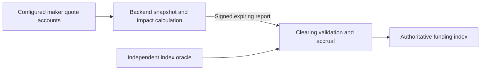

# Published-depth funding

## Selected boundary

The backend gathers a coherent snapshot of the complete configured maker set,
authenticates bindings/publications/code, and calculates published bid/ask totals
for the protocol reference quantity with the existing one/two-maker allocation,
depth/inventory/reduce-only caps, price bands and tie rules. D74's decision to omit
hypothetical financial admission remains in force. Reuse P30/P31's canonical
pricing and snapshot components; do not accidentally reuse the trader optimizer's
financial, fee or self-trade filters as funding policy.

The program authorizes the report publisher and validates a bounded report rather
than loading all maker accounts, hashing maker programs, invoking their quotes
and searching quantities on each sample. A report identifies its deployment/market,
configuration version, sequence, observation time/slot, expiry, Q and aggregate
bid/ask totals. Retain input provenance for independently reproducible audits;
a snapshot digest or publisher signature is not proof of correct aggregation.

The publisher must attest complete coverage and fresh valid maker inputs. Those
claims move to the publisher trust boundary; they are not described as fully
verified on-chain. A valid signed report can still be dishonest within accepted
price bounds. Limits bound the permitted effect; replay monitoring can detect
errors, but does not cryptographically prevent them.

On-chain authority remains narrowly scoped: the report cannot directly set an
arbitrary cumulative funding index, withdraw cash, change risk prices, bypass
trade margin checks or change fees/insurance. Clearing derives the bounded premium
and elapsed-time accrual using the independent index and authoritative Clock.
It materializes the preceding valid interval before installing a new prospective
observation. Reports cannot backdate funding or renew a cached input's freshness.

Observe account changes or slots in the backend, but initially publish on the
existing two-second cadence. Preserve six-second maximum hold, shorter input
expiry, recovery and outage behavior. Publication frequency is not a guarantee
of exact landing time. Keep financial admission at actual execution, independent
risk valuation, all-or-nothing routes and funded cash versus unpaid claims.

## Frozen publisher contract — D76

This is the implemented D76 report/authority contract.
Scope remains the fresh profile4 local qualification artifact; V1–V3 are unchanged.

- `FundingPublisher` PDA: `["funding-publisher-v4", market]`, clearing-owned,
  148 bytes including the discriminator. Borsh field order: schema_version u16=6; revision u64;
  venue, market, publisher Pubkeys; authority_epoch, last_sequence,
  last_observed_slot u64; last_observed_time i64; enabled bool; bump u8.
- `FundingReport` instruction payload: 203 bytes. Field order: version u16=1,
  domain [u8;32], market Pubkey; authority_epoch, sequence,
  expected_observation_sequence, expected_config_epoch, expected_terms_epoch,
  observed_slot u64; observed_time i64; valid_until_slot u64; valid_until_time i64;
  reference_price, quantity, bid, ask u64; outcome u8; input_digest [u8;32].
  Prices/totals are collateral atoms per lot / collateral atoms respectively.
  Digest is SHA-256 over the builder's versioned ordered raw snapshot, not a proof.
  Digest v1 encodes UTF-8 JSON `["rivalt-funding-snapshot-v1", context-slot decimal,
  rows]`, with address-sorted `[key,[owner,executable,base64-bytes]]` rows and null
  for absent accounts. Clock and RPC context are retained separately: the former
  supplies report time/slot, the latter orders discovery/final-batch reads. The
  program independently rejects future observed time/slot at landing.
- Outcomes: 0 available, 1 invalid independent sources, 2 unavailable/invalid maker
  coverage, 3 insufficient published depth. Unavailable reports have zero reference,
  quantity, bid, ask and both validity endpoints; all require a nonzero audit digest.
- Initialize requires venue authority in unpaused custody mode, initialized source
  bindings, a sealed complete registry and a nonzero publisher. Authority epoch=1,
  last_sequence=0; initial observed-slot/time fences are the authoritative Clock.
- Rotate/revoke requires venue authority and an exact current authority epoch.
  A nonzero new publisher rotates/enables; zero revokes. In custody/active modes,
  materialize/truncate old funding, advance market observation sequence and
  authority epoch, preserve report sequence, and fence observations at this Clock.
  Revocation is also allowed while paused/frozen/resolved/retired; outside custody/
  active modes it changes only publisher authority/fences and custody event
  sequence, not market/default financial state. Enabling outside custody/active
  modes or while paused is rejected. No publisher can rotate its own authority.
- Publish requires an enabled matching publisher transaction signer, no extra
  accounts, the profile gate and unpaused custody/active mode. Require exact venue
  domain/market, authority epoch, next report sequence (`last_sequence+1`), current
  market observation/config/terms epochs. Observed slot must be strictly newer than
  the config fence and no later than Clock; time must be nondecreasing, not future,
  and at most two seconds old. Available expiry must exceed Clock and be no later
  than observed time+6 seconds / observed slot+150. These caps do not independently
  prove the backend's declared input expiry; that is its attestation obligation.
- Independently read/authenticate the four existing source accounts on-chain. An
  available report requires Normal bounds and exact matching current reference;
  Q remains ceil(6,000,000/reference), ask>=bid>0 and each aggregate VWAP within
  90–110% of index. On-chain signed premium/cap and all funding arithmetic remain
  unchanged. Unavailable reports use the normal failed-observation transition.
- Accept only at the existing two-second sample interval. Accrue the preceding
  valid interval first; install the new sample from landing Clock, never from the
  historical observation time. Its hold also ends at the report's shorter expiry.
  Persist report sequence/observation fences and emit report plus resulting market
  state. Invalid reports revert every effect. Authority/control changes invalidate
  prepared reports through epoch/observation CAS; pure repricing retains the
  bounded snapshot-lag trust assumption and does not rewrite already-held funding.
- Disable `sample_liquidity_v4` in the new source; it cannot compete with reports.
  No new financial activation instruction is enabled by this replacement.
- Resource gate: submit publisher updates with 200,000 CU, require measured maximum
  <=160,000 CU (20% headroom), <=20 unique loaded keys, default32KiB heap and existing
  measured v0/v1 packet bounds. Initialize/rotate/revoke use the same 200k/160k gate.
  These are acceptance ceilings. A miss requires repair or an explicit recorded
  contract change, not silent budget inflation. Route gates remain unchanged.

The backend must authenticate complete current maker coverage, preserve all
publication/depth/capacity rules, select exact best published one/two-maker totals
and use the earliest actual publication expiry. It must reject mixed/old snapshots,
record source inputs and never re-date cached observations. Default/devnet handlers
remain gated. New artifacts require fresh affected acceptance; historical results do not qualify a rebuild.

## Calculation and causal time

The backend requires all three sealed authenticated makers, even when a valid
maker contributes zero size. Missing, expired, disabled, quarantined or code-mismatched
required inputs make coverage unavailable. A valid one-sided/inventory-limited
maker can have zero side capacity; each aggregate side must still fill all Q with
at most two capitals. Never choose a convenient incomplete subset.

Reference is 10,000–100,000 quote atoms/lot and
`Q = ceil(6,000,000/reference)` (60–600). Authenticate complete code hashes and
current identity, inventory, shape, price and clearing consumption. Apply declared
capacity/reduce-only bounds and 90–110% index prices. Search exact best published
single/pair totals with routing's deterministic ties, without taker fee, hypothetical
maker health, order reservations, synthetic cash, or consumed-depth writes.

Require `ask >= bid > 0`. Premium is signed truncation toward zero of
`(bid + ask - 2*Q*reference)*1e9/(2*Q)`, clamped to
`±reference*1e9*50/10000`. This is a scaled price-per-lot increment, not a dimensionless
funding rate. Period is 3,600 seconds; publication interval at least two seconds;
maximum hold/recovery six seconds, catch-up 30 seconds, outage 12 seconds. The hold
ends earlier at the actual source/publication/report expiry (both time and slot).

Materialize the previous valid interval before installing the new landing-time
observation. A failed/unavailable observation preserves already consumed prefixes,
records uncovered time, and cannot backcharge a gap. Structural controls close and
truncate old funding at actual Clock, count covered/skipped time once and install
an unqualified observation; unchanged repricing cannot rewrite the held sample.
Recovery cannot bridge expiry. A report never refreshes independent risk sources.

At scale 1e9, premium truncation is <1 scaled atom/lot; one original causal prefix
adds <1 scaled atom/lot. Against an ideal six-second rational hold the per-sample
index error is <(1+6/3600) scaled units. At 1e8 participant lots the absolute bound
is <0.101 quote atom per sample, before cap; participant checkpoint accrual itself
is exact. No fraction transfers to a later entrant.

## Audit and limitations

Persist the signed original and exact ordered raw inputs/digest atomically before
broadcast. An independent replay must reproduce the report, not call the same
pricing implementation twice. Clearing bounds a dishonest authorized publisher's
effect but does not prove coverage or optimality. Financially unexecutable published
depth can influence funding. Failure-based automatic maker exclusion remains
deferred; quarantine invalidates complete coverage rather than creating a new set.
